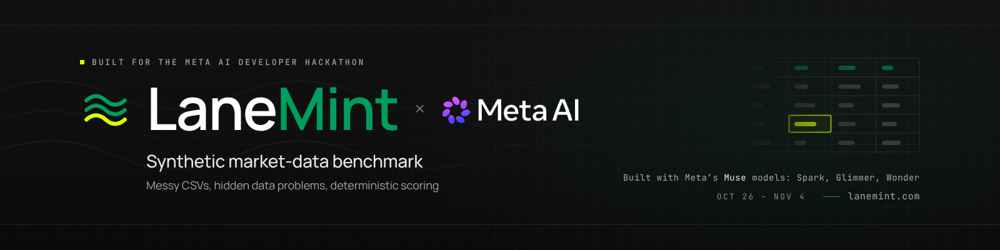
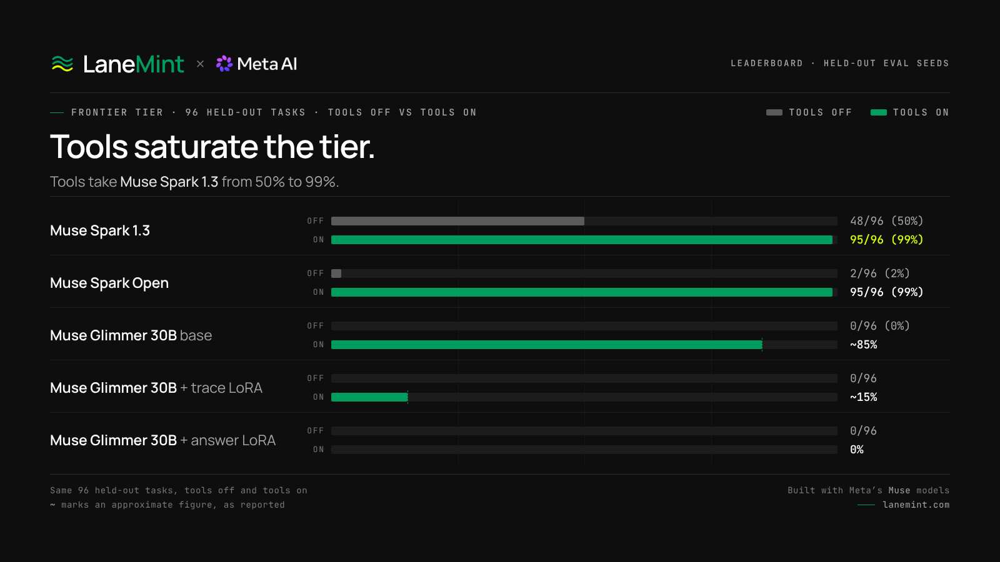
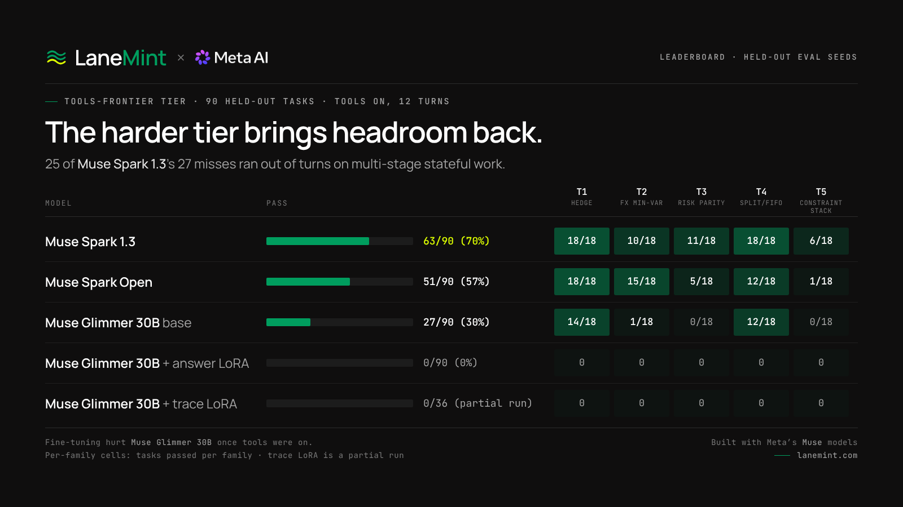

# Meta AI Developer Hackathon Benchmark

[](https://github.com/alsopgroup/lanemint-meta-hackathon/actions/workflows/test.yml)
[](https://www.python.org/downloads/)

> A synthetic benchmark for evaluating language models on financial data quality tasks



Built for Meta's AI Developer Hackathon (October 26 - November 4, 2026) by [LaneMint](https://lanemint.com).

---

**LaneMint × Meta Benchmark is a benchmark of hard quant-finance coding and data tasks, graded on hidden, procedurally generated synthetic market data.** Every task is generated from a seed, so the evaluation set is effectively unlimited and unseen by any model; the graded frontier tier asks a model to clean messy multi-asset price data and carry out long chains of exact numeric work — rolling risk, vendor reconciliation, factor exposure, and a full portfolio pipeline — where one wrong intermediate step fails the task. It exists to push Meta's Muse models to their frontier: the strongest model we ran passes only half of it. The project was built predominantly with Meta's **Muse Wonder** model in Cursor: after an initial scaffold (repo structure, data generator, runner, easy tier), all development from the hard tier onward was done with Muse Wonder.

**Live demo:** https://meta.lanemint.com
**Demo video:** coming Nov 3 <!-- TODO: replace this placeholder with the demo video link -->
**Full technical reference:** the previous long-form README is preserved at [docs/BENCHMARK.md](docs/BENCHMARK.md).

## Try it in two minutes

1. **Open the live app and click “Try a sample →”.** Go to [meta.lanemint.com](https://meta.lanemint.com) and press the **Try a sample →** button in the hero (or **Upload CSV** to pick a file yourself). The built-in sample runs straight away so you can see the checker flag problems and explain them in plain English.
2. **Download a sample CSV and upload it.** Grab a ready-made CSV from [`samples/`](samples/) (for example `samples/task_001.csv`), upload it in the app, and run the check. Because that file exactly matches a public sample, the app recognises it and gives you the full score against its answer key, just like the built-in samples. Any other CSV still gets findings, but its Score tab stays disabled — scoring needs an answer key, and only the `samples/` files have one in the app. See [`samples/README.md`](samples/README.md) for what each file contains and how to read its answer key.
3. **Generate your own fresh data.** One command makes a new, never-seen easy-tier set with its own answer keys:

   ```bash
   python -m src.generate_tasks --tier easy --seed 123 --count 3 --output-dir my_samples
   ```

   Use any seed you like for your own data, but do not use the reserved evaluation seeds (42, 1001, 1002) for training or tuning — those are held out for the headline results.

## Headline results

Held-out frontier results, pooled over the evaluation seeds **42, 1001 and 1002** (96 tasks, 4 families × 24), run at low reasoning effort. Pass rates are whole-percent with Wilson 95% confidence intervals.

| Model | Provider | F1 Rolling risk | F2 Vendor reconciliation | F3 Factor exposure | F4 Portfolio pipeline | Total | Pass rate (95% CI) |
|---|---|---|---|---|---|---|---|
| Muse Spark 1.3 | Meta API | 13/24 | 17/24 | 14/24 | 4/24 | **48/96** | **50% (40–60%)** |
| Muse Spark Open | Fireworks serverless | 1/24 | 0/24 | 1/24 | 0/24 | **2/96** | **2% (1–7%)** |
| Muse Glimmer 30B (base) | Fireworks | 0/24 | 0/24 | 0/24 | 0/24 | **0/96** | **0% (0–4%)** |
| Muse Glimmer 30B + trace LoRA | Fireworks | — | — | — | — | **0/96** | **0%** |
| Muse Glimmer 30B + answer LoRA | Fireworks | — | — | — | — | **0/96** | **0%** |

These numbers are read from [`app/data/leaderboard.json`](app/data/leaderboard.json), which is the **single source of truth** — the live demo's leaderboard renders that file, and this table is kept in sync with it. Updating the results means editing that one file (totals and intervals are recomputed and validated server-side).

Honest footnotes (also shown in the app):

- Muse Spark Open: 5 of its tasks failed on API errors (dropped connections, 1 timeout) and were counted as failures.
- Spark Open's and Glimmer 30B (base)'s seed-42 F1 results used the earlier 3-window version of F1; all other runs use the current 4-window version.

## Results

### Chart 1 — Frontier tier (96 held-out tasks), tools off vs tools on

**Headline: tools take Spark 1.3 from 50% to 99%, so the tier saturates once tools are on.**

| Model | Tools off | Tools on |
|---|---|---|
| Muse Spark 1.3 | 48/96 (50%) | 95/96 (99%) |
| Muse Spark Open | 2/96 (2%) | 95/96 (99%) |
| Muse Glimmer 30B (base) | 0/96 (0%) | ~85% |
| Glimmer 30B + trace LoRA | 0/96 | ~15% |
| Glimmer 30B + answer LoRA | 0/96 | 0% |



`~` marks an approximate figure, as reported. With tools on, both Spark models reach 95/96 on this tier, while Glimmer 30B (base) rises from 0% to roughly 85%.

### Chart 2 — `tools_frontier` tier (90 held-out tasks, tools on, 12 turns)

**Headline: the harder tool tier brings Spark 1.3 back to 70%, with a clear spread across models (70 / 57 / 30).**

| Model | Pass | T1 hedge | T2 FX min-var | T3 risk parity | T4 split/FIFO | T5 constraint stack |
|---|---|---|---|---|---|---|
| Muse Spark 1.3 | 63/90 (70%) | 18/18 | 10/18 | 11/18 | 18/18 | 6/18 |
| Muse Spark Open | 51/90 (57%) | 18/18 | 15/18 | 5/18 | 12/18 | 1/18 |
| Muse Glimmer 30B (base) | 27/90 (30%) | 14/18 | 1/18 | 0/18 | 12/18 | 0/18 |
| Glimmer + answer LoRA | 0/90 (0%) | 0 | 0 | 0 | 0 | 0 |
| Glimmer + trace LoRA | 0/36 (partial run) | 0 | 0 | 0 | 0 | 0 |



Most Spark 1.3 misses (25 of 27) are running out of turns on multi-stage stateful work. Per-family cells show tasks passed per family; the trace LoRA row is a partial run.

**Secondary finding: fine-tuning Glimmer on answers/traces hurt it once tools were on.** On the frontier tier with tools on, Glimmer 30B (base) reaches roughly 85%, compared with roughly 15% for the trace LoRA and 0% for the answer LoRA; on `tools_frontier`, both LoRA variants score 0% against 30% for the base model.

## How Meta tools are used

- **Meta API — Muse Spark 1.3.** The flagship model is evaluated through Meta's OpenAI-compatible API (`https://api.meta.ai/v1`) by the runner (`src/runner.py`) and powers the live mode of the demo app.
- **Fireworks — Muse Spark Open and Muse Glimmer 30B.** The open Muse models are evaluated through Fireworks (serverless for Spark Open; Glimmer 30B served on an H200), using the same runner pointed at Fireworks' OpenAI-compatible endpoint.
- **Glimmer LoRA SFT pipeline.** `src/finetune_prep.py` + `src/finetune.py` build a seed-disjoint supervised fine-tuning dataset for Muse Glimmer 30B and validate it against Fireworks' SFT rules. The locked evaluation seeds (42/1001/1002) are refused as training seeds **by construction** — training uses separate seeds (planned: 2001–2040), directories must declare their seed, and an optional hash check against the built eval sets refuses the run on any overlap.
- **Muse Wonder in Cursor.** After an initial scaffold (repo structure, data generator, runner, easy tier), all development from the hard tier onward was done with Meta's Muse Wonder model in Cursor — the hard and frontier tiers, scorer hardening, fine-tuning pipeline, demo app, tests, and this README — including the pilot-driven recalibration of the frontier families.

## How it works

```
seed ──► generator ──► task CSVs + answer keys ──► model (Meta API / Fireworks)
                                                        │  JSON answer
                                                        ▼
                              deterministic scorer ◄── parsed answer
                                   │  pass / fail + score
                                   ▼
                     pooled multi-seed results + Wilson CIs
```

### Task families (frontier tier)

| Family | Type | What the model must do |
|---|---|---|
| F1 | `frontier_rolling_risk` | Clean and align two assets and an index, then report rolling-window betas against the index and final-window volatility. |
| F2 | `frontier_vendor_reconciliation` | Reconcile two vendor price feeds that disagree, decide which source to trust date by date, and report reconciled return and drawdown. |
| F3 | `frontier_factor_exposure` | Apply a stated split adjustment, then run a two-factor regression and report exposures and fit. |
| F4 | `frontier_portfolio_pipeline` | Run the full pipeline: clean, align, hold and rebalance a multi-asset portfolio on a schedule with trading costs, and report checkpoint values and drawdown. |

Below the frontier tier sit an **easy tier** (clear-cut data problems: duplicates, gaps, bad prices, simple splits) and a **hard tier** (multi-asset panels, intraday/DST handling, unit changes, harder analytics) — useful as on-ramps and sanity checks, but close to saturated for strong models.

### Generation, held-out seeds, and scoring

- **Procedurally generated, seeded.** A seeded random-walk generator produces clean prices, plants known data problems at recorded rows, and emits the task CSV plus its answer key. Same seed → same tasks, byte for byte; new seed → a fresh, unseen exam.
- **Held-out evaluation seeds.** Headline numbers pool three seeds (42, 1001, 1002) that are never used for training or tuning data. Pooling 96 tasks instead of trusting one 32-task run is deliberate: at n=32 a handful of tasks swings the headline by tens of points.
- **Scoring outside the model.** Model output is parsed strictly (a non-object answer scores 0, it never crashes the run) and graded by a separate deterministic scorer (`src/scorer.py`): a task passes only when the set of data problems it reports is exactly right **and** its overall numeric score is at least 0.8 **and** each family's core numeric fields are themselves correct within tight tolerances — so plausible-looking guessed constants cannot pass.
- **Why intervals, not just percentages.** Every rate is reported with a Wilson 95% interval. Spark 1.3's 50% (40–60%) and Spark Open's 2% (1–7%) are clearly separated; a single-seed table would overstate that precision.
- **Why near-perfect scores were rejected.** During development, easier variants of these families scored at or near 100% for the flagship model — a benchmark everyone aces measures nothing. The frontier tier was deliberately recalibrated through repeated pilots (family sizes, window counts, and which fields are mandatory) until the strongest model landed mid-band, where differences between models are visible and a fine-tune has something to gain. An independent solver written from the task statements scores 100% on the shipped tasks, so the tier is hard, not broken.

## Reproduce

Requires Python 3.11+.

```bash
# Install
pip install -r requirements.txt

# Generate a held-out frontier eval set (seed 42, 32 tasks, 8 per family)
python -m src.generate_tasks --tier frontier --seed 42 --count 32 --output-dir tasks_eval_42

# Dry-run the runner (no API calls) and score the placeholder answers
python -m src.runner --tasks-dir tasks_eval_42 --dry-run --limit 3 --output-dir output/readme_check
python -m src.scorer output/readme_check/results.json tasks_eval_42/answers
```

Run a real model (needs your own key — never commit one):

```bash
export META_API_KEY=<your-meta-api-key>
export META_BASE_URL=https://api.meta.ai/v1        # default; Fireworks: https://api.fireworks.ai/inference/v1
export META_MODEL_NAME=muse-spark-1.3              # or a Fireworks Muse model string
python -m src.runner --tasks-dir tasks_eval_42 --reasoning-effort low
python -m src.scorer output/results.json tasks_eval_42/answers
```

Run the demo app locally:

```bash
cd app
pip install -r requirements.txt
python -m uvicorn main:app --port 8000
# open http://localhost:8000 — without META_API_KEY it runs in clearly
# labelled simulated mode; with it, the live Muse Spark mode is used.
```

Run the tests:

```bash
pytest tests/ -q          # benchmark, scorer, runner, fine-tune prep
pip install -r app/requirements.txt httpx
pytest app/tests -q       # demo app API, leaderboard, live/demo fallback
```

## Run with Docker

Only Docker (with the Compose plugin) is needed — no local Python. From a fresh clone:

```bash
# Optional: copy the env template if you want live mode later.
# With no keys set, everything below still works in demo/offline mode.
cp .env.example .env   # then fill in keys in .env only — never commit it

# (1) Live web app (the same app/ service deployed at meta.lanemint.com):
docker compose up --build app
# open http://localhost:8000 · health: http://localhost:8000/healthz
# Without META_API_KEY it runs in clearly labelled simulated/demo mode.
# Set APP_PORT if 8000 is taken, e.g. APP_PORT=8080 docker compose up --build app

# (2) Sample benchmark run (offline, no keys, no API calls):
docker compose --profile benchmark run --rm benchmark
# Generates a fresh easy-tier set (seed 123, 3 tasks), runs the runner
# with --dry-run (stub model) and scores it. The stub's placeholder
# answers are expected to score 0 — this proves the pipeline, not a
# model. The scoring summary is printed in the terminal; the
# throwaway container is then removed (`--rm`).
```

Any other benchmark command can be run in the same container by passing it through, e.g. `docker compose --profile benchmark run --rm benchmark python -m src.runner --help`. For a live run, put your key in the gitignored `.env` (or export it) and drop `--dry-run`; note that live mode needs `META_API_KEY` and Meta's Model API is region-gated to the US region. `FIREWORKS_API_KEY` and `META_SITE_API_KEY` are likewise only ever passed at runtime via the environment / `.env` file — no secrets are baked into either image.

Without Compose, the equivalent plain Docker commands are:

```bash
docker build -t lanemint-meta-app ./app
docker run --rm -p 8000:8000 lanemint-meta-app          # demo mode without keys

docker build -f Dockerfile.benchmark -t lanemint-meta-benchmark .
docker run --rm lanemint-meta-benchmark                 # offline sample run
```

This does not change the Railway deployment: Railway still builds `app/Dockerfile` with `app/` as its root directory, exactly as before.

## Fine-tuning Muse Glimmer 30B

The fine-tuning path is designed so the headline evaluation can never leak into training:

- **Seed-disjoint by construction.** `src/finetune_prep.py` refuses the locked eval seeds (42, 1001, 1002) as dataset seeds; task directories must declare their generation seed (`--tasks-dir <dir>@<seed>`), and there is no implicit default directory to fall back on. Planned training data: frontier seeds 2001–2040 (train 2001–2036, validation 2037–2040, split by whole seed).
- **Hash-level guard.** With `--eval-dirs` pointing at the built eval sets, any training or validation row whose CSV or answer hash-collides with an eval task refuses the run before anything is written. A `manifest.json` records the generator commit, seeds, per-family counts, and per-file hashes.
- **Validated, never auto-executed.** `src/finetune.py` validates the JSONL against Fireworks SFT rules (row/token limits, message shape) and then **prints** the `firectl dataset create` / `firectl sftj create` commands (LoRA rank 16, 2 epochs, base `muse-glimmer-30b`) for a human to review and run. Nothing in this repo calls Fireworks training APIs automatically.

```bash
# Build seed-disjoint SFT data (small verified example). --eval-dirs
# turns on the hash-level guard against the locked eval set built in
# 'Reproduce' above (repeat --eval-dirs for tasks_eval_1001/1002 in a
# full run): any CSV/answer hash collision refuses the run.
python -m src.finetune_prep --tier frontier --seeds 3001-3002 --count 4 --val-seeds 3002 --eval-dirs tasks_eval_42 --output-dir finetune_data
# Validate and print the Fireworks plan (executes nothing)
python -m src.finetune --train-file finetune_data/train.jsonl --validation-file finetune_data/validation.jsonl --dry-run
```

**Status:** LoRA results are reported in [Results](#results) above. With tools on, both LoRA variants underperform Glimmer 30B (base) — fine-tuning on answers/traces hurt Glimmer once tools were available.

## The demo app

The app in `app/` (deployed at https://meta.lanemint.com) lets judges try the easy-tier checker interactively: upload or pick a sample CSV, watch Muse Spark flag duplicates, gaps, bad prices and unadjusted splits in plain English, and see the deterministic score. With `META_API_KEY` set server-side it calls Muse Spark 1.3 live (the key never reaches the browser; per-IP and daily caps guard the endpoint); without a key it falls back to a clearly labelled simulated mode — the page always shows which mode you are in. Its leaderboard section renders the same `app/data/leaderboard.json` quoted above. See `app/README.md` for deployment (Railway) details.

## Limitations and honest notes

- **Synthetic data only.** Tasks are procedurally generated; they are designed to measure cleaning-plus-computation reliability, not real-world market knowledge, and contain no real securities data.
- **API failures count as failures.** Spark Open's 2% includes 5 tasks lost to API errors (dropped connections, 1 timeout) on the serving side, not wrong answers.
- **F1 changed mid-flight.** Spark Open's and Glimmer base's seed-42 F1 results predate the current 4-window F1 (they used a 3-window version); all other results use the current version. Pooled totals mix the two only for those two models' seed-42 slice.
- **One run per model.** Headline numbers are single pooled runs at low reasoning effort, not averages over repeated runs; the Wilson intervals are the honest precision statement.
- **Fine-tuning hurt with tools on.** The answer- and trace-LoRA variants underperform Glimmer 30B (base) once tools are available (see [Results](#results)); how much of the Spark/Glimmer gap is trainable remains open.
- **Demo vs benchmark.** The interactive demo exercises the easy-tier checker for accessibility; the graded frontier tier is run through the CLI pipeline above, not in the browser.

## License and credits

No open-source license has been attached to this repository yet — all rights are reserved by LaneMint; please ask before reusing the code outside this hackathon.

Credits: built by [LaneMint](https://lanemint.com) for the Meta AI Developer Hackathon. Models: Meta Muse Spark 1.3 (Meta API), Muse Spark Open and Muse Glimmer 30B (Fireworks). After an initial scaffold (repo structure, data generator, runner, easy tier), all development from the hard tier onward was done with Meta's Muse Wonder model in Cursor. The benchmark contains only procedurally generated synthetic data — no private LaneMint data, tasks, or grading assets.
