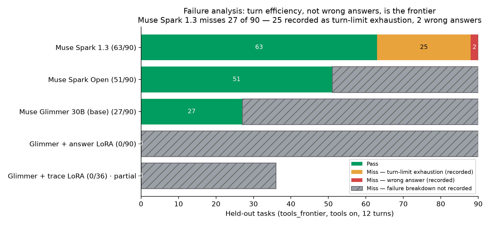
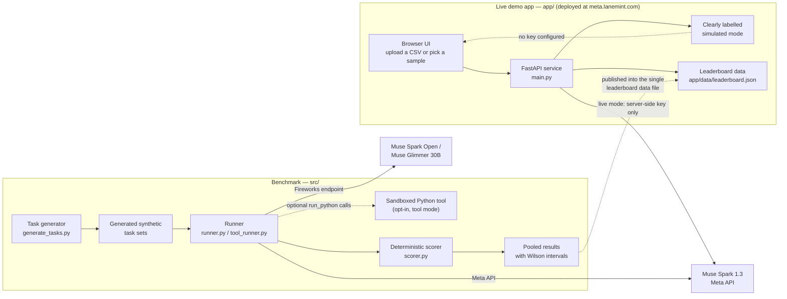

# Meta AI Developer Hackathon Benchmark

[](https://github.com/alsopgroup/lanemint-meta-hackathon/actions/workflows/test.yml)
[](https://www.python.org/downloads/)

> **One-line pitch:** a procedurally generated benchmark and live demo that test Meta's Muse models on hard quant-finance data-cleaning and exact numeric work — graded by a deterministic scorer, not by another model.


Built for Meta's Global AI Developer Hackathon (October 26 – November 4, 2026) by [LaneMint](https://lanemint.com), as a new project created during the hackathon.

## Headline finding: turn efficiency, not raw capability, is the frontier

On the held-out `tools_frontier` tier (tools on, 12 turns, 90 tasks), **Muse Spark 1.3 solves 70% (63/90) — and 25 of its 27 misses are recorded in the results data as turn-limit exhaustion, not wrong answers** (only 2 misses are wrong answers; see the failure analysis in [Results](#results)). The model usually knows how to do the work; it runs out of turns doing it, so the next gains on long, exact, multi-step data work come from turn efficiency — fewer, better-planned tool calls — not from raw capability alone.

Quant researchers and data engineers spend much of their time cleaning vendor price files before any real analysis can start. Bad ticks, duplicates, gaps and unadjusted splits silently corrupt backtests when they slip through, so a model that can do long, exact, multi-step data work reliably is the one they would actually use.

**▶ Live demo:** https://meta.lanemint.com · **🎬 Demo video:** https://youtu.be/r-mvSwYUFLc · **🐳 Quick start:** `docker compose up --build app` → http://localhost:8000

**Full technical reference:** the previous long-form README is preserved at [docs/BENCHMARK.md](docs/BENCHMARK.md).

## Contents

- [Headline finding](#headline-finding-turn-efficiency-not-raw-capability-is-the-frontier)
- [At a glance for judges](#at-a-glance-for-judges)
- [Try it in two minutes](#try-it-in-two-minutes)
- [Meta models used](#meta-models-used)
- [Architecture](#architecture)
- [Headline results](#headline-results)
- [Results](#results)
- [How it works](#how-it-works)
- [Reproduce](#reproduce)
- [Run with Docker](#run-with-docker)
- [Fine-tuning Muse Glimmer 30B](#fine-tuning-muse-glimmer-30b)
- [The demo app](#the-demo-app)
- [Hugging Face dataset](#hugging-face-dataset)
- [Limitations and honest notes](#limitations-and-honest-notes)
- [License and credits](#license-and-credits)

## At a glance for judges

| Judging pillar | What to look at |
|---|---|
| **Impact & alignment** | Financial data quality is real, unglamorous, and consequential when it goes wrong. This benchmark measures whether a model can clean messy market data and carry exact numeric work through to a correct answer — and the live demo lets anyone try that checker on their own CSV. |
| **Meta AI tooling** | Muse Spark 1.3 powers the live app and headlines the benchmark; Muse Spark Open and Muse Glimmer 30B are evaluated through Fireworks; Glimmer LoRA fine-tuning experiments run through a validated SFT pipeline. See [Meta models used](#meta-models-used). |
| **Technical depth** | Procedurally generated, effectively unlimited unseen tasks; a deterministic scorer outside the model; an opt-in sandboxed Python tool mode for the runner; and pooled multi-seed results reported with confidence intervals. See [How it works](#how-it-works). |
| **Demo completeness** | A live deployed app, a two-minute judge path, one-command Docker for both the app and an offline benchmark sample, and full reproduce commands. See [Try it in two minutes](#try-it-in-two-minutes) and [Run with Docker](#run-with-docker). |

**LaneMint × Meta Benchmark is a benchmark of hard quant-finance coding and data tasks, graded on procedurally generated synthetic market data.** Because every task is generated, the evaluation set is effectively unlimited and unseen by any model; the graded frontier tier asks a model to clean messy multi-asset price data and carry out long chains of exact numeric work — rolling risk, vendor reconciliation, factor exposure, and a full portfolio pipeline — where one wrong intermediate step fails the task. It exists to push Meta's Muse models to their frontier: the strongest model we ran passes only half of it without tools.

**Results in one line:** on the hardest held-out tool tier (`tools_frontier`, 90 tasks, tools on, 12 turns), Muse Spark 1.3 passes **70%**, Muse Spark Open **57%**, and Muse Glimmer 30B **30%** — and most Spark 1.3 misses are simply running out of turns on multi-stage work. Full tables are in [Results](#results).

## Try it in two minutes

1. **Open the live app and click “Try a sample →”.** Go to [meta.lanemint.com](https://meta.lanemint.com) and press the **Try a sample →** button in the hero (or **Upload CSV** to pick a file yourself). The built-in sample runs straight away so you can see the checker flag problems and explain them in plain English.
2. **Download a sample CSV and upload it.** Grab a ready-made CSV from [`samples/`](samples/) (for example `samples/task_001.csv`), upload it in the app, and run the check. Because that file exactly matches a public sample, the app recognises it and gives you the full score against its answer key, just like the built-in samples. Any other CSV still gets findings, but its Score tab stays disabled — scoring needs an answer key, and only the `samples/` files have one in the app. See [`samples/README.md`](samples/README.md) for what each file contains and how to read its answer key.
3. **Generate your own fresh data.** One command makes a new, never-seen easy-tier set with its own answer keys:

   ```bash
   python -m src.generate_tasks --tier easy --seed 123 --count 3 --output-dir my_samples
   ```

   Use any seed you like for your own data, but do not use the reserved evaluation seeds (42, 1001, 1002) for training or tuning — those are held out for the headline results.

## Headline results

Held-out frontier results, pooled over the evaluation seeds **42, 1001 and 1002** (96 tasks, 4 families × 24), run at low reasoning effort. Pass rates are whole-percent with Wilson 95% confidence intervals.

| Model | Provider | F1 Rolling risk | F2 Vendor reconciliation | F3 Factor exposure | F4 Portfolio pipeline | Total | Pass rate (95% CI) |
|---|---|---|---|---|---|---|---|
| Muse Spark 1.3 | Meta API | 13/24 | 17/24 | 14/24 | 4/24 | **48/96** | **50% (40–60%)** |
| Muse Spark Open | Fireworks serverless | 1/24 | 0/24 | 1/24 | 0/24 | **2/96** | **2% (1–7%)** |
| Muse Glimmer 30B (base) | Fireworks | 0/24 | 0/24 | 0/24 | 0/24 | **0/96** | **0% (0–4%)** |
| Muse Glimmer 30B + trace LoRA | Fireworks | — | — | — | — | **0/96** | **0%** |
| Muse Glimmer 30B + answer LoRA | Fireworks | — | — | — | — | **0/96** | **0%** |

These numbers are read from [`app/data/leaderboard.json`](app/data/leaderboard.json), which is the **single source of truth** — the live demo's leaderboard renders that file, and this table is kept in sync with it. Updating the results means editing that one file (totals and intervals are recomputed and validated server-side).

Honest footnotes (also shown in the app):

- Muse Spark Open: 5 of its tasks failed on API errors (dropped connections, 1 timeout) and were counted as failures.
- Spark Open's and Glimmer 30B (base)'s seed-42 F1 results used the earlier 3-window version of F1; all other runs use the current 4-window version.

## Results

### Chart 1 — Frontier tier (96 held-out tasks), tools off vs tools on

**Headline: tools take Spark 1.3 from 50% to 99%, so the tier saturates once tools are on.**

| Model | Tools off | Tools on |
|---|---|---|
| Muse Spark 1.3 | 48/96 (50%) | 95/96 (99%) |
| Muse Spark Open | 2/96 (2%) | 95/96 (99%) |
| Muse Glimmer 30B (base) | 0/96 (0%) | ~85% |
| Glimmer 30B + trace LoRA | 0/96 | ~15% |
| Glimmer 30B + answer LoRA | 0/96 | 0% |


`~` marks an approximate figure, as reported. With tools on, both Spark models reach 95/96 on this tier, while Glimmer 30B (base) rises from 0% to roughly 85%.

### Chart 2 — `tools_frontier` tier (90 held-out tasks, tools on, 12 turns)

**Headline: the harder tool tier brings Spark 1.3 back to 70%, with a clear spread across models (70 / 57 / 30).**

| Model | Pass | T1 hedge | T2 FX min-var | T3 risk parity | T4 split/FIFO | T5 constraint stack |
|---|---|---|---|---|---|---|
| Muse Spark 1.3 | 63/90 (70%) | 18/18 | 10/18 | 11/18 | 18/18 | 6/18 |
| Muse Spark Open | 51/90 (57%) | 18/18 | 15/18 | 5/18 | 12/18 | 1/18 |
| Muse Glimmer 30B (base) | 27/90 (30%) | 14/18 | 1/18 | 0/18 | 12/18 | 0/18 |
| Glimmer + answer LoRA | 0/90 (0%) | 0 | 0 | 0 | 0 | 0 |
| Glimmer + trace LoRA | 0/36 (partial run) | 0 | 0 | 0 | 0 | 0 |


Most Spark 1.3 misses (25 of 27) are running out of turns on multi-stage stateful work. Per-family cells show tasks passed per family; the trace LoRA row is a partial run.

### How solid are these numbers?

| Model | Passes (of 90) | 95% interval (Wilson) |
|---|---|---|
| Spark 1.3 | 63 (70.0%) | 59.9–78.5% |
| Spark Open | 51 (56.7%) | 46.4–66.4% |
| Glimmer base | 27 (30.0%) | 21.5–40.1% |
| Glimmer + LoRA V3 | 26 (28.9%) | 20.5–39.0% |

Held-out set: 30 tasks × 3 public seeds. In paired tests on the same items, both Spark models clearly beat Glimmer base (p < 0.001). Spark 1.3's lead over Spark Open is smaller and only just significant (p ≈ 0.04). LoRA V3 is statistically indistinguishable from Glimmer base (−1.1 pp, 95% CI −12 to +10 pp, p = 1.0).

### Failure analysis — pass vs turn-limit miss vs wrong answer



Generated by [`scripts/failure_analysis.py`](scripts/failure_analysis.py) from the existing results data in [`app/data/leaderboard.json`](app/data/leaderboard.json) only — nothing was rerun. The turn-limit/wrong-answer split is drawn only for Muse Spark 1.3, the one model whose failure breakdown is recorded in that data (25 of 27 misses: turn-limit exhaustion); for the other models the miss segment is shown as "breakdown not recorded" rather than inventing a split. This is the chart behind the headline finding: **turn efficiency, not raw capability, is the frontier.**

**Secondary finding: fine-tuning Glimmer on answers/traces hurt it once tools were on.** On the frontier tier with tools on, Glimmer 30B (base) reaches roughly 85%, compared with roughly 15% for the trace LoRA and 0% for the answer LoRA; on `tools_frontier`, both LoRA variants score 0% against 30% for the base model.

**Reading the LoRA rows honestly:** the Glimmer LoRA experiments were deliberately small in scope — limited training runs fitted into hackathon time and available compute — and under those constraints both variants underperformed Glimmer 30B (base) once tools were on (~15% / 0% vs ~85% on the frontier tier; 0% vs 30% on `tools_frontier`, with the trace-LoRA `tools_frontier` run only partial). The SFT pipeline itself is built and validated end to end (see [Fine-tuning](#fine-tuning-muse-glimmer-30b)); the fair conclusion is that this limited-scope experiment did not help, not that fine-tuning Glimmer cannot — a properly resourced training run remains open future work.

**LoRA V3 (later experiment, not on `main`):** a third adapter was trained on the Glimmer base from passing Muse Spark Open teacher trajectories in the same `run_python`, 12-turn tools harness; it lives on the `lora-v3` branch, not `main`. On the held-out `tools_frontier` eval (the same 90 tasks as the leaderboard above), V3 scored 26/90 against 27/90 for base Glimmer, so there was no accuracy gain. What changed was behaviour: V3 always produced a final answer (0 empty answers vs 50 for base) and hit the turn limit far less often (23 vs 64); it gained on `fx_calendar` tasks (1 → 5) but lost a similar amount on `convention_risk` (14 → 12) and `split_holdings` (12 → 9). The honest takeaway is that fine-tuning taught Glimmer to finish, not to be more correct — with more time and compute, the next step would be more varied teacher data.

## Meta models used

Every model below is wired into the code in this repo — file references are given so judges can verify each claim.

| Model | Used for | Where in the repo |
|---|---|---|
| **Muse Spark 1.3** (Meta API) | Live mode of the web app, and the headline benchmark model | `app/muse_client.py` (default `META_MODEL_NAME=muse-spark-1.3`, Meta's OpenAI-compatible API at `https://api.meta.ai/v1`); `src/runner.py` uses the same defaults |
| **Muse Spark Open** (Fireworks serverless) | Benchmark evaluation | The same runner, pointed at Fireworks' OpenAI-compatible endpoint via `META_BASE_URL` / `META_MODEL_NAME` |
| **Muse Glimmer 30B** (Fireworks) | Benchmark evaluation, plus LoRA fine-tuning experiments | The same runner via Fireworks; `src/finetune_prep.py` + `src/finetune.py` build and validate the LoRA SFT pipeline (base model `accounts/fireworks/models/muse-glimmer-30b`) |
| **Muse Wonder** (`muse-wonder-1.0`, in Cursor) | The coding model that built this project | All development from the hard tier onward — tiers, scorer, fine-tuning pipeline, demo app, tests and docs — was done with Muse Wonder in Cursor, after an initial scaffold (repo structure, data generator, runner, easy tier). See the development note in [docs/BENCHMARK.md](docs/BENCHMARK.md) |

**Inference paths, named plainly (model IDs are the exact strings the code calls):**

- **Meta Model API (`api.meta.ai`) — Muse Spark 1.3, model ID `muse-spark-1.3`.** Evaluated through Meta's OpenAI-compatible Model API (`https://api.meta.ai/v1`, the `META_MODEL_NAME` default in `src/runner.py`) and powers the live mode of the demo app (`app/muse_client.py`, same default).
- **Fireworks (official inference partner) — Muse Spark Open and Muse Glimmer.** Evaluated through Fireworks' OpenAI-compatible endpoint (`https://api.fireworks.ai/inference/v1`), using the same runner with `META_MODEL_NAME` pointed at the Fireworks model string (serverless for Spark Open; Glimmer 30B served on an H200). The Fireworks model ID hardcoded in the code is the Glimmer SFT base, `accounts/fireworks/models/muse-glimmer-30b` (`src/finetune.py`); the LoRA output models are named `muse-glimmer-30b-lora-answer` and `muse-glimmer-30b-lora-trace` there. No other Fireworks model ID is hardcoded — the runner always takes it from `META_MODEL_NAME`.
- **Multimodal (live app).** The demo app's chart-image check sends an uploaded chart/table image to Muse Spark 1.3 through the same Meta Model API Chat Completions path: per Meta's image-understanding docs, `muse-spark-1.3` accepts image input as an `image_url` content part (base64 data URL) in a `user` message, which is exactly what `check_chart_image` in `app/muse_client.py` sends — no substitute model or endpoint. See [The demo app](#the-demo-app).

In short:

- **Meta API — Muse Spark 1.3.** The flagship model is evaluated through Meta's OpenAI-compatible API (`https://api.meta.ai/v1`) by the runner (`src/runner.py`) and powers the live mode of the demo app.
- **Fireworks — Muse Spark Open and Muse Glimmer 30B.** The open Muse models are evaluated through Fireworks (serverless for Spark Open; Glimmer 30B served on an H200), using the same runner pointed at Fireworks' OpenAI-compatible endpoint.
- **Glimmer LoRA SFT pipeline.** `src/finetune_prep.py` + `src/finetune.py` build a seed-disjoint supervised fine-tuning dataset for Muse Glimmer 30B and validate it against Fireworks' SFT rules; nothing calls the training APIs automatically — the pipeline prints the commands for a human to review and run (see [Fine-tuning](#fine-tuning-muse-glimmer-30b)).
- **Muse Wonder in Cursor.** After the initial scaffold, all development from the hard tier onward was done with Meta's Muse Wonder model in Cursor — including the pilot-driven recalibration of the frontier families.

## Architecture



Two independent paths share the same Muse models: the **app** answers one CSV at a time for a human (live Muse Spark when a server-side key is configured, otherwise a clearly labelled simulated mode), while the **benchmark** generates fresh synthetic task sets, runs a model over them (optionally with a sandboxed Python tool), and grades every answer with a deterministic scorer outside the model. Published leaderboard numbers live in the single data file the app renders.

## How it works

```
seed ──► generator ──► task CSVs + answer keys ──► model (Meta API / Fireworks)
                                                        │  JSON answer
                                                        ▼
                              deterministic scorer ◄── parsed answer
                                   │  pass / fail + score
                                   ▼
                     pooled multi-seed results + Wilson CIs
```

### Task families (frontier tier)

| Family | Type | What the model must do |
|---|---|---|
| F1 | `frontier_rolling_risk` | Clean and align two assets and an index, then report rolling-window betas against the index and final-window volatility. |
| F2 | `frontier_vendor_reconciliation` | Reconcile two vendor price feeds that disagree, decide which source to trust date by date, and report reconciled return and drawdown. |
| F3 | `frontier_factor_exposure` | Apply a stated split adjustment, then run a two-factor regression and report exposures and fit. |
| F4 | `frontier_portfolio_pipeline` | Run the full pipeline: clean, align, hold and rebalance a multi-asset portfolio on a schedule with trading costs, and report checkpoint values and drawdown. |

Below the frontier tier sit an **easy tier** (clear-cut data problems: duplicates, gaps, bad prices, simple splits) and a **hard tier** (multi-asset panels, intraday/DST handling, unit changes, harder analytics) — useful as on-ramps and sanity checks, but close to saturated for strong models.

### Generation, held-out seeds, and scoring

- **Procedurally generated, seeded.** A seeded random-walk generator produces clean prices, plants known data problems at recorded rows, and emits the task CSV plus its answer key. Same seed → same tasks, byte for byte; new seed → a fresh, unseen exam.
- **Held-out evaluation seeds.** Headline numbers pool three seeds (42, 1001, 1002) that are never used for training or tuning data. Pooling 96 tasks instead of trusting one 32-task run is deliberate: at n=32 a handful of tasks swings the headline by tens of points.
- **Scoring outside the model.** Model output is parsed strictly (a non-object answer scores 0, it never crashes the run) and graded by a separate deterministic scorer (`src/scorer.py`): a task passes only when the set of data problems it reports is exactly right **and** its overall numeric score is at least 0.8 **and** each family's core numeric fields are themselves correct within tight tolerances — so plausible-looking guessed constants cannot pass.
- **Why intervals, not just percentages.** Every rate is reported with a Wilson 95% interval. Spark 1.3's 50% (40–60%) and Spark Open's 2% (1–7%) are clearly separated; a single-seed table would overstate that precision.
- **Why near-perfect scores were rejected.** During development, easier variants of these families scored at or near 100% for the flagship model — a benchmark everyone aces measures nothing. The frontier tier was deliberately recalibrated through repeated pilots (family sizes, window counts, and which fields are mandatory) until the strongest model landed mid-band, where differences between models are visible and a fine-tune has something to gain. An independent solver written from the task statements scores 100% on the shipped tasks, so the tier is hard, not broken.

## Reproduce

Requires Python 3.11+.

```bash
# Install
pip install -r requirements.txt

# Generate a held-out frontier eval set (seed 42, 32 tasks, 8 per family)
python -m src.generate_tasks --tier frontier --seed 42 --count 32 --output-dir tasks_eval_42

# Dry-run the runner (no API calls) and score the placeholder answers
python -m src.runner --tasks-dir tasks_eval_42 --dry-run --limit 3 --output-dir output/readme_check
python -m src.scorer output/readme_check/results.json tasks_eval_42/answers
```

Run a real model (needs your own key — never commit one):

```bash
export META_API_KEY=<your-meta-api-key>
export META_BASE_URL=https://api.meta.ai/v1        # default; Fireworks: https://api.fireworks.ai/inference/v1
export META_MODEL_NAME=muse-spark-1.3              # or a Fireworks Muse model string
python -m src.runner --tasks-dir tasks_eval_42 --reasoning-effort low
python -m src.scorer output/results.json tasks_eval_42/answers
```

Run the demo app locally:

```bash
cd app
pip install -r requirements.txt
python -m uvicorn main:app --port 8000
# open http://localhost:8000 — without META_API_KEY it runs in clearly
# labelled simulated mode; with it, the live Muse Spark mode is used.
```

Run the tests:

```bash
pytest tests/ -q          # benchmark, scorer, runner, fine-tune prep
pip install -r app/requirements.txt httpx
pytest app/tests -q       # demo app API, leaderboard, live/demo fallback
```

## Run with Docker

Only Docker (with the Compose plugin) is needed — no local Python. From a fresh clone:

```bash
# Optional: copy the env template if you want live mode later.
# With no keys set, everything below still works in demo/offline mode.
cp .env.example .env   # then fill in keys in .env only — never commit it

# (1) Live web app (the same app/ service deployed at meta.lanemint.com):
docker compose up --build app
# open http://localhost:8000 · health: http://localhost:8000/healthz
# Without META_API_KEY it runs in clearly labelled simulated/demo mode.
# Set APP_PORT if 8000 is taken, e.g. APP_PORT=8080 docker compose up --build app

# (2) Sample benchmark run (offline, no keys, no API calls):
docker compose --profile benchmark run --rm benchmark
# Generates a fresh easy-tier set (seed 123, 3 tasks), runs the runner
# with --dry-run (stub model) and scores it. The stub's placeholder
# answers are expected to score 0 — this proves the pipeline, not a
# model. The scoring summary is printed in the terminal; the
# throwaway container is then removed (`--rm`).
```

Any other benchmark command can be run in the same container by passing it through, e.g. `docker compose --profile benchmark run --rm benchmark python -m src.runner --help`. For a live run, put your key in the gitignored `.env` (or export it) and drop `--dry-run`; note that live mode needs `META_API_KEY` and Meta's Model API is region-gated to the US region. `FIREWORKS_API_KEY` and `META_SITE_API_KEY` are likewise only ever passed at runtime via the environment / `.env` file — no secrets are baked into either image.

Without Compose, the equivalent plain Docker commands are:

```bash
docker build -t lanemint-meta-app ./app
docker run --rm -p 8000:8000 lanemint-meta-app          # demo mode without keys

docker build -f Dockerfile.benchmark -t lanemint-meta-benchmark .
docker run --rm lanemint-meta-benchmark                 # offline sample run
```

This does not change the Railway deployment: Railway still builds `app/Dockerfile` with `app/` as its root directory, exactly as before.

## Fine-tuning Muse Glimmer 30B

The fine-tuning path is designed so the headline evaluation can never leak into training:

- **Seed-disjoint by construction.** `src/finetune_prep.py` refuses the locked eval seeds (42, 1001, 1002) as dataset seeds; task directories must declare their generation seed (`--tasks-dir <dir>@<seed>`), and there is no implicit default directory to fall back on. Planned training data: frontier seeds 2001–2040 (train 2001–2036, validation 2037–2040, split by whole seed).
- **Hash-level guard.** With `--eval-dirs` pointing at the built eval sets, any training or validation row whose CSV or answer hash-collides with an eval task refuses the run before anything is written. A `manifest.json` records the generator commit, seeds, per-family counts, and per-file hashes.
- **Validated, never auto-executed.** `src/finetune.py` validates the JSONL against Fireworks SFT rules (row/token limits, message shape) and then **prints** the `firectl dataset create` / `firectl sftj create` commands (LoRA rank 16, 2 epochs, base `muse-glimmer-30b`) for a human to review and run. Nothing in this repo calls Fireworks training APIs automatically.

```bash
# Build seed-disjoint SFT data (small verified example). --eval-dirs
# turns on the hash-level guard against the locked eval set built in
# 'Reproduce' above (repeat --eval-dirs for tasks_eval_1001/1002 in a
# full run): any CSV/answer hash collision refuses the run.
python -m src.finetune_prep --tier frontier --seeds 3001-3002 --count 4 --val-seeds 3002 --eval-dirs tasks_eval_42 --output-dir finetune_data
# Validate and print the Fireworks plan (executes nothing)
python -m src.finetune --train-file finetune_data/train.jsonl --validation-file finetune_data/validation.jsonl --dry-run
```

**Status:** LoRA results are reported in [Results](#results) above. Treat them as what they are: **small, compute- and time-constrained experiments — a baseline others can beat**, not a finished fine-tuning result. Those experiments were kept deliberately small under hackathon time and compute constraints, and under those constraints both LoRA variants underperform Glimmer 30B (base) once tools are available — fine-tuning on answers/traces hurt it once tools were on. That is a limited-scope result, not a verdict on fine-tuning Glimmer: the data pipeline, seed-disjointness guards and validation above are the reusable output, and a larger training run is the obvious next step. No downloadable adapter weights are included in this repo (see [docs/HUGGINGFACE.md](docs/HUGGINGFACE.md)).

## The demo app

The app in `app/` (deployed at https://meta.lanemint.com) lets judges try the easy-tier checker interactively: upload or pick a sample CSV, watch Muse Spark flag duplicates, gaps, bad prices and unadjusted splits in plain English, and see the deterministic score. With `META_API_KEY` set server-side it calls Muse Spark 1.3 live (the key never reaches the browser; per-IP and daily caps guard the endpoint); without a key it falls back to a clearly labelled simulated mode — the page always shows which mode you are in. Its leaderboard section renders the same `app/data/leaderboard.json` quoted above. See `app/README.md` for deployment (Railway) details.

**Chart image check (multimodal).** The app also accepts a chart image or screenshot of a price series (or a statement/table screenshot): Muse Spark 1.3 receives it as image input through the Meta Model API (see [Meta models used](#meta-models-used)) and returns visible data problems — spikes, gaps, flat stretches, split-like level shifts — plus the extracted series as a table, shown in the UI. The same live-mode protections apply (image validated server-side, per-IP/daily caps, `reasoning_effort` low, model pinned server-side, key never reaches the browser). Without a key it runs in the clearly labelled simulated mode: the three bundled sample chart images (generated from the public `samples/` data by `scripts/make_sample_charts.py`) return their labelled simulated results, and any other image gets an honest "not a bundled sample" notice instead of invented findings — so judges and Docker users can try the feature with no credentials.

## Hugging Face dataset

A frozen public subset of the benchmark (easy, hard and frontier tiers, generated from new public seeds — never the held-out eval seeds) is published on Hugging Face at **[huggingface.co/datasets/LaneMint/lanemint-meta-benchmark](https://huggingface.co/datasets/LaneMint/lanemint-meta-benchmark)**. `scripts/export_hf_dataset.py` builds the dataset folder (task CSVs, answer keys, dataset card), and [docs/HUGGINGFACE.md](docs/HUGGINGFACE.md) has the exact `hf upload` commands used to publish it, plus what exists for the Glimmer LoRA work (no adapter weights in this repo).

## Limitations and honest notes

- **Synthetic data only.** Tasks are procedurally generated; they are designed to measure cleaning-plus-computation reliability, not real-world market knowledge, and contain no real securities data.
- **API failures count as failures.** Spark Open's 2% includes 5 tasks lost to API errors (dropped connections, 1 timeout) on the serving side, not wrong answers.
- **F1 changed mid-flight.** Spark Open's and Glimmer base's seed-42 F1 results predate the current 4-window F1 (they used a 3-window version); all other results use the current version. Pooled totals mix the two only for those two models' seed-42 slice.
- **One run per model.** Headline numbers are single pooled runs at low reasoning effort, not averages over repeated runs; the Wilson intervals are the honest precision statement.
- **Fine-tuning scope.** The answer- and trace-LoRA variants underperform Glimmer 30B (base) once tools are available (see [Results](#results)), but those were small, deliberately constrained experiments run within hackathon time and compute limits — they show that limited-scope fine-tuning did not help here, not that Glimmer cannot be fine-tuned; how much of the Spark/Glimmer gap is trainable remains open.
- **Demo vs benchmark.** The interactive demo exercises the easy-tier checker for accessibility; the graded frontier tier is run through the CLI pipeline above, not in the browser.

## License and credits

No open-source license has been attached to this repository yet — all rights are reserved by LaneMint; please ask before reusing the code outside this hackathon.

Credits: built by [LaneMint](https://lanemint.com) for the Meta AI Developer Hackathon. Models: Meta Muse Spark 1.3 (Meta API), Muse Spark Open and Muse Glimmer 30B (Fireworks). After an initial scaffold (repo structure, data generator, runner, easy tier), all development from the hard tier onward was done with Meta's Muse Wonder model in Cursor. The benchmark contains only procedurally generated synthetic data — no private LaneMint data, tasks, or grading assets.
