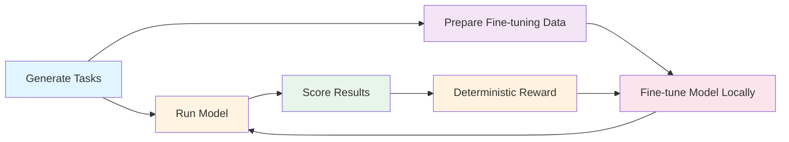

# Meta AI Developer Hackathon Benchmark

[](https://github.com/alsopgroup/lanemint-meta-hackathon/actions/workflows/test.yml)
[](https://www.python.org/downloads/)

> A synthetic benchmark for evaluating language models on financial data quality tasks


Built for Meta's AI Developer Hackathon (October 26 - November 4, 2026) by [LaneMint](https://lanemint.com).

---

## Overview

Test language models on their ability to detect and handle data quality issues in financial time series. The benchmark offers two difficulty tiers:

- **Easy tier**: Baseline tasks with clear problems (duplicates, missing days, bad prices, 2:1 splits) and explicit cleaning rules
- **Hard tier**: Complex multi-problem scenarios (multi-asset panels, timezone/DST issues, unit changes, reverse splits, harder analytics) where prompts state computation rules but don't enumerate problems

Each task asks the model to identify issues and compute metrics. A deterministic scorer validates responses with detailed feedback.

### Workflow



### Key Features

- 🎯 **Two difficulty tiers**: Easy (baseline) and Hard (frontier-challenging)
- 📊 **~25 tasks per tier** with known data quality issues
- ✅ **Deterministic scoring** with detailed per-problem feedback
- 🧪 **Dry-run mode** for safe testing without API costs
- 🔧 **Local fine-tuning** targeting open-weights Muse Glimmer (30B)
- 🎁 **Scorer as reward** for GRPO-based reinforcement learning
- 🔓 **Zero external dependencies** on proprietary data or code

---

## Quickstart

```bash
# Clone and install
git clone https://github.com/alsopgroup/lanemint-meta-hackathon.git
cd lanemint-meta-hackathon
pip install -r requirements.txt

# Generate tasks
python -m src.generate_tasks

# Run dry-run (no API calls)
python -m src.runner --dry-run

# Score results
python -m src.scorer output/results.json
```

See [full usage guide](#usage) below.

---

## Setup

### Prerequisites

- Python 3.11+
- pip

### Installation

```bash
# Clone and enter the repository
git clone https://github.com/alsopgroup/lanemint-meta-hackathon.git
cd lanemint-meta-hackathon

# Install dependencies
pip install -r requirements.txt

# Configure environment (copy template)
cp .env.example .env
```

### Environment Configuration

Edit `.env` and set your Meta API credentials (do not commit this file):

```bash
META_API_KEY=your_api_key_here
META_BASE_URL=https://api.meta.ai/v1
META_MODEL_NAME=muse-spark-1.3

# Optional: muse-spark-1.3 is a reasoning model
# Reasoning tokens count against max_tokens; increase if answers are truncated
META_MAX_TOKENS=16000

# Optional: control reasoning effort (if supported by model)
# META_REASONING_EFFORT=medium
```

The API is OpenAI-compatible. Available models: `muse-spark-1.3` (default), `muse-spark-1.2`, `muse-spark-1.1`.

**Note**: `META_MAX_TOKENS` defaults to 16000. Muse Spark 1.3 is a reasoning model where reasoning tokens count against the limit, so a higher value prevents truncated answers.

---

## Usage

### 1. Generate Tasks

Create synthetic market data tasks with quality issues:

```bash
# Generate easy tier (default)
python -m src.generate_tasks

# Generate hard tier
python -m src.generate_tasks --tier hard
```

This creates:
- `tasks/tasks.json` - Task definitions and prompts
- `tasks/task_*.csv` (easy) or `tasks/task_h_*.csv` (hard) - Dirty market data CSV files
- `tasks/answers/` - Expected answers (hidden from model)

**Options**:
- `--tier {easy,hard}`: Difficulty tier (default: easy)
- `--seed SEED`: Random seed for reproducibility (default: 42)
- `--count COUNT`: Number of tasks to generate (default: 25)
- `--output-dir DIR`: Output directory (default: tasks/)

#### Tier Comparison

| Aspect | Easy Tier | Hard Tier |
|--------|-----------|-----------|
| **Problem Types** | Duplicates, missing days, bad ticks, 2:1 splits | Multi-asset panels, timezone/DST, unit changes, reverse splits (1:10, 3:1), out-of-order rows, conflicting adj_close |
| **Prompt Style** | Lists expected problems and cleaning rules | States computation rules only; problems not enumerated |
| **Analytics** | Simple (mean return, volatility, total return) | Complex (max drawdown, rolling beta, equal-weight portfolio with rebalancing) |
| **Problem Count** | 2-3 problems per task | 2-4 interacting problems per task |
| **Target Pass Rate** | ~90%+ for frontier models | ~20-60% for frontier models |
| **Task IDs** | `task_001`, `task_002`, ... | `task_h_1001`, `task_h_1002`, ... |

**Important**: The default seed 42 is reserved for the evaluation set. Use different seeds when generating training data to avoid train/eval overlap:

```bash
# Easy tier evaluation set (seed 42, default)
python -m src.generate_tasks

# Hard tier evaluation set (seed 42)
python -m src.generate_tasks --tier hard

# Training data (different seeds)
python -m src.generate_tasks --seed 100 --count 100 --output-dir train_tasks_100
python -m src.generate_tasks --tier hard --seed 200 --count 50 --output-dir train_hard_200
```

### 2. Run Tasks (Dry Run)

Test the full pipeline with a stub model (no API calls):

```bash
python -m src.runner --dry-run
```

Output saved to `output/results.json`.

### 3. Score Results

Evaluate model responses against expected answers:

```bash
python -m src.scorer output/results.json
```

Shows pass/fail for each task with detailed feedback.

### 4. Prepare Fine-Tuning Data

Split tasks into training and validation sets for local fine-tuning:

```bash
python -m src.finetune_prep
```

Creates:
- `finetune_data/train.jsonl` - SFT training examples (80%)
- `finetune_data/validation.jsonl` - Validation examples (20%)
- `finetune_data/validation_task_ids.json` - Held-out task IDs

The JSONL format is compatible with TRL (Hugging Face) and Axolotl for QLoRA fine-tuning.

### 5. Fine-Tune Locally (Planned)

Fine-tune **Muse Glimmer** (30B dense, Apache 2.0) locally using the prepared data:

**Target model**: `meta-models/Muse-Glimmer-30B` (Hugging Face) or `meta-models/Muse-Glimmer-30B-GGUF`

**Approaches**:
- **Supervised Fine-Tuning (SFT)**: Use `train.jsonl` with TRL's `SFTTrainer` or Axolotl for QLoRA
- **GRPO (Group Relative Policy Optimization)**: Use `src/scorer.py` as a deterministic reward function with TRL's `GRPOTrainer` or Meta's TitanRL data-analyst recipe

```bash
# Estimate data size and check format (dry-run, no training)
python -m src.finetune --dry-run

# For actual fine-tuning, see TRL or Axolotl documentation
# Optional: install fine-tuning dependencies
# pip install -e ".[finetune]"
```

**Note**: Fine-tuning requires GPU resources. The scorer provides deterministic rewards for reinforcement learning approaches.

### 6. Running Real Model Evaluation

Once you have Meta API access configured:

```bash
# Run baseline with Muse Spark
python -m src.runner --output-dir output/baseline

# Score baseline
python -m src.scorer output/baseline/results.json

# After local fine-tuning, point to your fine-tuned model endpoint
# Update META_BASE_URL and META_MODEL_NAME in .env, then:
python -m src.runner --output-dir output/finetuned

# Score fine-tuned results
python -m src.scorer output/finetuned/results.json
```

---

## Project Structure

```
.
├── .github/
│   └── workflows/
│       └── test.yml              # CI/CD configuration
├── src/
│   ├── __init__.py
│   ├── generate_tasks.py         # Task and data generator (easy tier)
│   ├── hard_tier.py              # Hard tier task generator
│   ├── scorer.py                 # Deterministic scoring engine (also usable as reward function)
│   ├── runner.py                 # Model runner with dry-run mode
│   ├── finetune_prep.py          # Fine-tuning data preparation (SFT/GRPO)
│   └── finetune.py               # Fine-tuning configuration and validation
├── tests/
│   ├── __init__.py
│   ├── test_generate_tasks.py    # Easy tier tests
│   ├── test_hard_tier.py         # Hard tier tests
│   └── test_scorer.py            # Unit tests for scorer
├── tasks/                        # Generated tasks (gitignored)
├── output/                       # Model results (gitignored)
├── finetune_data/                # Training files (gitignored)
├── .env.example                  # Environment template
├── .gitignore                    # Git ignore rules
├── requirements.txt              # Python dependencies
└── README.md                     # This file
```

---

## Data Quality Issues

### Easy Tier

The easy tier injects these problems with explicit cleaning rules stated in prompts:

1. **Duplicate rows** - Same date appears twice
2. **Missing days** - Gaps in trading day sequence
3. **Bad prices** - Obvious price errors (spikes that revert: >50% deviation from both neighbors)
4. **Unadjusted 2:1 stock splits** - Sustained ~50% price drops requiring adjustment

Each easy task contains 2-3 problems. Prompts list which problem types may be present and provide exact cleaning steps.

### Hard Tier

The hard tier uses general, textbook data-quality problems (no stock-specific issues like delisted tickers, dividends, or stale prices):

1. **Multi-asset panels** - 3-6 tickers with misaligned trading calendars and exchange holidays
2. **Timezone/DST issues** - Intraday timestamps with mixed timezones or DST shifts causing duplicate/missing hours
3. **Unit changes** - Mid-series switch from dollars to cents (100x price jump)
4. **Currency mismatches** - One asset quoted in different currency, FX series provided
5. **Reverse splits** - 1:10 or 3:1 ratios (prices multiply), sometimes with conflicting `adj_close` column
6. **Out-of-order rows** - Shuffled row pairs requiring sort
7. **Header/column changes** - Concatenated exports with different column orders mid-file
8. **Complex analytics** - Max drawdown from peak, rolling 20-day beta vs index, equal-weight portfolio with periodic rebalancing

Hard tasks contain 2-4 interacting problems. Prompts state exact computation rules (return definition, ddof, alignment, how to treat missing values) without enumerating which problems are present, making the correct answer uniquely determined from the rules.

---

## Testing

Run unit tests:

```bash
pytest tests/ -v
```

Tests cover scorer logic, JSON parsing, and tolerance checks.

### CI/CD

GitHub Actions runs tests automatically on every push. The workflow includes:
- Unit test execution
- Full pipeline dry-run
- Scoring validation
- Fine-tuning data preparation

No secrets or API keys required for CI.

---

## Development

### Adding New Task Types

Edit `src/generate_tasks.py` and add a method like:

```python
def generate_task_your_type(self) -> Dict:
    # Generate data with problems
    # Return task dict with prompt and expected answer
```

Register it in `generate_all_tasks()`.

### Adjusting Scoring

Edit scoring logic in `src/scorer.py`:

- Modify tolerance in `compare_float()`
- Adjust pass threshold (default: 80%)
- Add new field validators

---

## Hackathon: Build for Your World

**Track**: Build for Your World  
**Event**: Meta AI Developer Hackathon  
**Dates**: October 26 - November 4, 2026

### Why Market Data Quality?

Market data is never clean in the real world. Duplicate rows, missing trading days, bad price ticks, and unadjusted stock splits corrupt backtests and portfolio analytics. Manual cleaning is brittle and expensive.

### Our Approach

1. **Synthetic benchmark**: Generate realistic market data with known quality issues
2. **Test Muse Spark**: Evaluate Meta's Muse models on data quality detection
3. **Deterministic scoring**: Validate responses with precise, reproducible grading
4. **Local fine-tuning**: Use the same scorer as a reward function for fine-tuning Muse Glimmer (30B, open-weights) with GRPO

The deterministic scorer enables both evaluation and reinforcement learning, closing the loop from detection to improvement.

### Optional Tooling

Meta's **Muse Code** (coding agent) can be used as optional tooling for development workflows, but is not required for the benchmark itself.

---

## Contributing

Contributions are welcome! Please see [CONTRIBUTING.md](CONTRIBUTING.md) for guidelines.

---

Built by [LaneMint](https://lanemint.com) for Meta's AI Developer Hackathon 2026.
