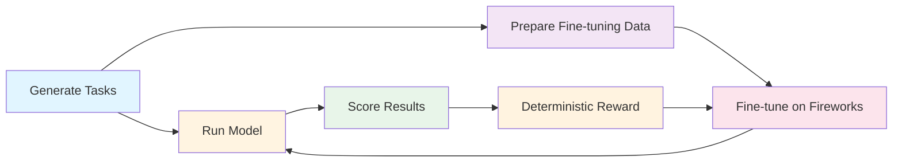

# Meta AI Developer Hackathon Benchmark

[](https://github.com/alsopgroup/lanemint-meta-hackathon/actions/workflows/test.yml)
[](https://www.python.org/downloads/)

> A synthetic benchmark for evaluating language models on financial data quality tasks


Built for Meta's AI Developer Hackathon (October 26 - November 4, 2026) by [LaneMint](https://lanemint.com).

---

## Overview

Test language models on their ability to detect and handle data quality issues in financial time series. The benchmark offers two difficulty tiers:

- **Easy tier**: Baseline tasks with clear problems (duplicates, missing days, bad prices, 2:1 splits) and explicit cleaning rules
- **Hard tier**: Complex multi-problem scenarios (multi-asset panels, timezone/DST issues, unit changes, reverse splits, harder analytics) where prompts state computation rules but don't enumerate problems

Each task asks the model to identify issues and compute metrics. A deterministic scorer validates responses with detailed feedback.

### Workflow



### Key Features

- 🎯 **Two difficulty tiers**: Easy (baseline) and Hard (more problems per task, combined)
- 📊 **25 tasks per tier by default** with known data quality issues
- ✅ **Deterministic scoring** with detailed per-problem feedback
- 🧪 **Dry-run mode** for safe testing without API costs
- 🔧 **Local fine-tuning** targeting open-weights Muse Glimmer (30B)
- 🎁 **Scorer as reward** for GRPO-based reinforcement learning
- 🔓 **Zero external dependencies** on proprietary data or code

---

## Quickstart

```bash
# Clone and install
git clone https://github.com/alsopgroup/lanemint-meta-hackathon.git
cd lanemint-meta-hackathon
pip install -r requirements.txt

# Generate tasks
python -m src.generate_tasks

# Run dry-run (no API calls)
python -m src.runner --dry-run

# Score results
python -m src.scorer output/results.json
```

See [full usage guide](#usage) below.

---

## Setup

### Prerequisites

- Python 3.11+
- pip

### Installation

```bash
# Clone and enter the repository
git clone https://github.com/alsopgroup/lanemint-meta-hackathon.git
cd lanemint-meta-hackathon

# Install dependencies
pip install -r requirements.txt

# Configure environment (copy template)
cp .env.example .env
```

### Environment Configuration

Edit `.env` and set your Meta API credentials (do not commit this file):

```bash
META_API_KEY=your_api_key_here
META_BASE_URL=https://api.meta.ai/v1
META_MODEL_NAME=muse-spark-1.3

# Optional: output token cap. Leave unset to use the runner defaults
# (16000 for easy-tier tasks, 32000 for hard- and frontier-tier tasks); setting this
# overrides all tiers, so do not set it to 16000 for hard/frontier runs.
# META_MAX_TOKENS=32000

# Optional: control reasoning effort (if supported by model)
# META_REASONING_EFFORT=medium
```

The API is OpenAI-compatible. Available models: `muse-spark-1.3` (default), `muse-spark-1.2`, `muse-spark-1.1`.

**Note**: the runner's token cap defaults to 32000 for hard-tier tasks (`task_h_*`) and 16000 for easy-tier tasks; `--max-tokens` or `META_MAX_TOKENS` overrides it. Muse Spark 1.3 is a reasoning model where reasoning tokens count against the limit, so a higher value prevents truncated answers. Reasoning effort is controlled with `--reasoning-effort {low,medium,high}` (or `META_REASONING_EFFORT`); by default the parameter is omitted from the API request entirely. Every recorded result entry carries its `model`, `max_tokens` and `reasoning_effort`, and `--resume` refuses to continue a result set whose recorded model, reasoning effort, or token cap differs from the current run's. For balanced pilots, `--per-family N` runs at most the first N tasks of each task type (in file order; default runs everything), and `--family TYPE` (repeatable) restricts the run to the named task types; a `--family` filter that matches 0 tasks (e.g. a misspelled type) is an error and exits non-zero instead of looking like a green run.

---

## Usage

### 1. Generate Tasks

Create synthetic market data tasks with quality issues:

```bash
# Generate easy tier (default)
python -m src.generate_tasks

# Generate hard tier
python -m src.generate_tasks --tier hard

# Generate frontier tier
python -m src.generate_tasks --tier frontier
```

This creates:
- Easy tier (default output `tasks/`): `tasks/tasks.json`, `tasks/task_*.csv`, `tasks/answers/`
- Hard tier (default output `tasks_hard/`, so it does not overwrite the easy set): `tasks_hard/tasks.json`, `tasks_hard/task_h_*.csv`, `tasks_hard/answers/`
- Frontier tier (default output `tasks_frontier/`): `tasks_frontier/tasks.json`, `tasks_frontier/task_f_*.csv`, `tasks_frontier/answers/`

**Options**:
- `--tier {easy,hard,frontier}`: Difficulty tier (default: easy)
- `--seed SEED`: Random seed for reproducibility (default: 42)
- `--count COUNT`: Number of tasks to generate (default: 25)
- `--output-dir DIR`: Output directory (default: `tasks/` for easy, `tasks_hard/` for hard)

#### Tier Comparison

| Aspect | Easy Tier | Hard Tier |
|--------|-----------|-----------|
| **Problem Types** | Duplicates, missing days, bad ticks, 2:1 splits | Misaligned calendars, mixed-timezone intraday bars, unit changes, currency conversion, reverse splits (1-for-3, 1-for-10), out-of-order rows, conflicting `adj_close`, column-order changes |
| **Prompt Style** | Lists expected problems, cleaning rules, and a one-line definition of each problem code | Gives one fixed list of problem codes, each with a one-line definition, plus general rules that apply whichever are present, then the exact analytic definition; it does not say which issues a file contains |
| **Analytics** | Mean/sample-std of returns, total return, annualised volatility | Equal-weight portfolio (inner-join alignment, holdings drift, reset every 20 return observations), max drawdown, rolling 20-observation beta, intraday-to-daily volatility |
| **Problem Count** | 2-3 problems per task | 1-4 problems per task (drawn per task) |
| **Task IDs** | `task_001`, `task_002`, ... | `task_h_1001`, `task_h_1002`, ... |

**Important**: The default seed 42 is reserved for the evaluation set. Use different seeds when generating training data to avoid train/eval overlap:

```bash
# Easy tier evaluation set (seed 42, default)
python -m src.generate_tasks

# Hard tier evaluation set (seed 42)
python -m src.generate_tasks --tier hard

# Training data (different seeds)
python -m src.generate_tasks --seed 100 --count 100 --output-dir train_tasks_100
python -m src.generate_tasks --tier hard --seed 200 --count 50 --output-dir train_hard_200
```

### 2. Run Tasks (Dry Run)

Test the full pipeline with a stub model (no API calls):

```bash
python -m src.runner --dry-run
```

Output saved to `output/results.json`.

### 3. Score Results

Evaluate model responses against expected answers:

```bash
python -m src.scorer output/results.json
```

Shows pass/fail for each task with detailed feedback.

### 4. Prepare Fine-Tuning Data

Build a Fireworks SFT dataset with `src/finetune_prep.py`. Tasks are generated in-process per seed (`--tier`/`--seeds`) or loaded from one or more task directories (`--tasks-dir`, repeatable; a directory's generation seed must be declared as `PATH@SEED` — undeclared directories are refused, so they cannot bypass the locked-seed check). There is no implicit default tasks directory: running with neither `--seeds` nor a declared `--tasks-dir` is refused, because the old implicit `tasks/` default is generated at locked seed 42.

**Seed-disjointness rule (mandatory):** training and validation data must be disjoint by generation seed from each other and from the locked eval seeds **42, 1001 and 1002**. The split is by whole seed (`--val-seeds`), never by shuffling tasks from the same seed across the split. `--exclude-seeds` (default `42,1001,1002`) refuses any dataset seed in the locked set; dropping a locked seed from that list (e.g. `--exclude-seeds ''`) is itself refused unless `--allow-eval-seeds` is passed explicitly, which prints a warning and must never be used for a real training run. `--eval-dirs` adds a SHA-256 check over training **and** validation rows: if any CSV or answer matches an eval task's, the run refuses before writing anything. All randomness uses a local `random.Random`, and every run writes a `manifest.json` (generator commit, seeds, per-family counts, token stats, SHA-256 of each output file).

```bash
# Build the locked eval sets first (these are the --eval-dirs inputs
# and the post-training evaluation sets; never train on them):
for s in 42 1001 1002; do
  python -m src.generate_tasks --tier frontier --seed $s --count 32 --output-dir tasks_eval_$s
done

# Planned dataset: frontier seeds 2001-2040, 32 tasks per seed;
# train on 2001-2036, validate on 2037-2040, guarded against the
# eval sets by SHA-256.
python -m src.finetune_prep --tier frontier --seeds 2001-2040 --count 32 \
    --val-seeds 2037-2040 --eval-dirs tasks_eval_42 --eval-dirs tasks_eval_1001 --eval-dirs tasks_eval_1002 \
    --target trace --output-dir finetune_data
```

Creates:
- `finetune_data/train.jsonl` - SFT training examples
- `finetune_data/validation.jsonl` - Held-out validation examples (the SFT evaluation dataset)
- `finetune_data/validation_task_ids.json` - Held-out task IDs (seed-qualified)
- `finetune_data/manifest.json` - Provenance, counts, token stats, output hashes

`--target {answer,trace}` selects the assistant target: `answer` is the final JSON only; `trace` adds a deterministic worked solution from `src/trace.py` (cleaning log, aligned counts, per-window/per-step intermediates, final values; capped by `--trace-max-tokens`). Fireworks SFT supports thinking traces as `reasoning_content` on the assistant message, so traces are stored in that field and `content` remains the final JSON — no trace text is embedded in `content`. `--families` restricts task types and `--mix` (e.g. `--mix hard=0.15,frontier=0.85`) downsamples groups to target proportions.

### 5. Fine-Tune on Fireworks

Fine-tune **Muse Glimmer 30B** with a LoRA adapter on Fireworks (managed SFT). `src/finetune.py` validates the dataset against the Fireworks SFT rules — 3 to 3,000,000 rows, valid message roles with a non-empty assistant message, and every row within `--max-context-length` tokens (default 32768; rows over the limit **fail** validation instead of being silently truncated by the platform) — and then prints, but never runs, the `firectl` commands:

```bash
# Validate and print the plan (dry-run; nothing is executed).
# --target must match the target the data was built with; it selects
# per-target dataset/output names (glimmer-sft-<target>,
# muse-glimmer-30b-lora-<target>) so answer and trace runs never collide.
python -m src.finetune --dry-run --target trace

# Printed plan (run manually after review; these are paid operations):
# firectl dataset create glimmer-sft-trace finetune_data/train.jsonl
# firectl dataset create glimmer-sft-trace-eval finetune_data/validation.jsonl
# firectl sftj create --base-model accounts/fireworks/models/muse-glimmer-30b \
#     --dataset glimmer-sft-trace --evaluation-dataset glimmer-sft-trace-eval \
#     --lora-rank 16 --epochs 2 --max-context-length 32768 \
#     --output-model muse-glimmer-30b-lora-trace
```

**Evaluation protocol:** after training, evaluate the LoRA model on the locked held-out frontier set — 96 tasks (seeds 42, 1001 and 1002 at `--count 32`) that were never trained or validated on — with the runner at **low reasoning effort** (the same setting as the frontier pilots), and report pass rates with Wilson score intervals. **Deployment teardown is mandatory:** delete the dedicated deployment (or unload the LoRA addon) as soon as evaluation finishes, so no fine-tuned endpoint is left running.

**Runner model strings for the LoRA model** (the runner takes `--model` / `META_MODEL_NAME`, with `META_BASE_URL` pointed at the Fireworks OpenAI-compatible endpoint `https://api.fireworks.ai/inference/v1`):

- Dedicated deployment of the tuned model: `--model accounts/<your-account>/models/muse-glimmer-30b-lora-trace` (the output model resource name; `-answer` for the answer-target run).
- Multi-LoRA deployment routing: `--model <model_name>#<deployment_name>` (the `#` form routes the request to that LoRA adapter on the named deployment; quote it in the shell).

```bash
# Evaluate on each locked eval set built in section 4 (shown: seed 42;
# repeat with tasks_eval_1001 and tasks_eval_1002 for the full 96 tasks):
META_BASE_URL=https://api.fireworks.ai/inference/v1 \
META_MODEL_NAME='accounts/<your-account>/models/muse-glimmer-30b-lora-trace' \
python -m src.runner --tasks-dir tasks_eval_42 --reasoning-effort low --output-dir output/glimmer_lora_42
python -m src.scorer output/glimmer_lora_42/results.json tasks_eval_42/answers
```

### 6. Running Real Model Evaluation

Once you have Meta API access configured:

```bash
# Run baseline with Muse Spark
python -m src.runner --output-dir output/baseline

# Score baseline
python -m src.scorer output/baseline/results.json

# After Fireworks fine-tuning, evaluate the LoRA deployment (see
# 'Fine-Tune on Fireworks' above for the model string forms), then:
python -m src.runner --output-dir output/finetuned

# Score fine-tuned results
python -m src.scorer output/finetuned/results.json
```

---

## Project Structure

```
.
├── .github/
│   └── workflows/
│       └── test.yml              # CI/CD configuration
├── src/
│   ├── __init__.py
│   ├── generate_tasks.py         # Task and data generator (easy tier)
│   ├── hard_tier.py              # Hard tier task generator
│   ├── frontier_tier.py          # Frontier tier task generator (F1-F4)
│   ├── scorer.py                 # Deterministic scoring engine (also usable as reward function)
│   ├── runner.py                 # Model runner with dry-run mode
│   ├── finetune_prep.py          # Seed-disjoint Fireworks SFT data preparation
│   ├── trace.py                  # Deterministic worked-solution traces
│   └── finetune.py               # Fireworks SFT validation + printed firectl plan
├── tests/
│   ├── __init__.py
│   ├── test_generate_tasks.py    # Easy tier tests
│   ├── test_hard_tier.py         # Hard tier tests
│   └── test_scorer.py            # Unit tests for scorer
├── scripts/
│   └── prompt_sizes.py           # Per-task prompt size report (chars/tokens)
├── tasks/                        # Generated tasks (gitignored)
├── output/                       # Model results (gitignored)
├── finetune_data/                # Training files (gitignored)
├── .env.example                  # Environment template
├── .gitignore                    # Git ignore rules
├── requirements.txt              # Python dependencies
└── README.md                     # This file
```

---

## Data Quality Issues

### Easy Tier

The easy tier injects these problems with explicit cleaning rules stated in prompts:

1. **Duplicate rows** - Same date appears twice
2. **Missing days** - Gaps in trading day sequence
3. **Bad prices** - Obvious price errors (spikes that revert: >50% deviation from both neighbors)
4. **Unadjusted 2:1 stock splits** - Sustained ~50% price drops requiring adjustment

Each easy task contains 2-3 problems. Prompts list which problem types may be present and provide exact cleaning steps.

### Hard Tier

The hard tier uses general, textbook data-quality problems. It does not use delisted stocks/survivorship, ticker renames, dividends, stale or repeated prices, or too-short history. Consecutive closes for a ticker are never identical, and OHLC bars are internally consistent (`low ≤ open, close ≤ high`).

The default 25 hard tasks cycle through five task types, five of each. For every task, a bundle of 1–4 problems is drawn (seeded) from those compatible with that task's analytic, so the problem set is not fixed by task type. Calendar misalignment is labelled for portfolio tasks only when the tickers' date sets really differ, and counts toward that task's total, so every hard key lists between 1 and 4 categories:

1. **Multi-asset portfolio** (3 tickers) - equal-weight portfolio with inner-join alignment, holdings drifting and resetting every 20 return observations. Compatible problems: US/European calendar misalignment (only labelled when the tickers' date sets really differ), out-of-order rows, reverse split, unit change, EUR quotation with a per-date `fx_rate` column (USD per EUR), conflicting `adj_close`, reordered second header block
2. **Max drawdown** - maximum drawdown from the running peak. Compatible problems: dollars-to-cents unit change, reverse split, out-of-order rows, conflicting `adj_close`, duplicate row, missing row, a second header block with reordered columns partway through the file
3. **Rolling beta** - mean of rolling 20-observation betas against the IDX benchmark. Compatible problems: EUR/`fx_rate` currency conversion, reverse split, unit change, conflicting `adj_close`, out-of-order rows, duplicate row, missing row, reordered second header block
4. **Intraday timezone/DST** - bars at 01:00–20:00 New-York time across the March 2024 spring-forward, timestamps mixing UTC and offset forms (the 20:00 bar's UTC date is the next day), one instant repeated in a second textual form; the daily close is the last bar per New-York date. Compatible extra problems: out-of-order rows, reordered second header block, conflicting `adj_close`, currency conversion, unit change, reverse split, duplicate bar, missing bar
5. **Single-asset volatility** - annualised volatility. Compatible problems: unit change, reverse split, conflicting `adj_close`, out-of-order rows, duplicate row, missing row, reordered second header block

Reverse splits multiply prices by exactly 3 or exactly 10; the prompts state that an observed sustained jump is snapped to whichever of the candidate ratios {3, 10} is relatively closest. Scaled values are rounded to 2 decimals, so no float artefacts mark the changed rows.

Every hard prompt carries the same fixed list of problem codes, each with a precise one-line definition (for example, `calendar` is when tickers trade on different date sets although each is complete on its own calendar, while `missing` is a gap inside one ticker's own calendar; a repeated intraday instant in a different textual form, placed next to its first occurrence, is `timezone`, not `duplicate` or `out_of_order`), and the same general rules (parsing, ordering, `close` vs `adj_close`, FX direction, timezone conversion and de-duplication, sustained-shift adjustment with the {3, 10} candidate set, return definition, ddof=1, annualisation, inner-join alignment, rounding), so the prompt does not reveal which issues a given file contains and the answer is determined by the stated rules. The easy prompts likewise define each of their four codes. An independent solver in `tests/independent_solver.py`, written separately from the reference code, reproduces every numeric key in the test suite, and a rule-based detector in `tests/category_detector.py`, written from the prompt definitions alone, reproduces every key's problem set exactly across seeds 1-200 on both tiers.

### Problem identification scoring

Prompts ask for a JSON `problems` array containing only category codes from the fixed list (easy tier: `duplicate`, `missing`, `bad_price`, `split`; hard tier: those plus `reverse_split`, `unit_change`, `out_of_order`, `timezone`, `currency`, `adj_close`, `column_order`, `calendar`). The scorer compares the returned codes with the key's categories using precision and recall (F1), so returning extra codes — including the whole list — lowers the score on both tiers. A legacy free-text `problems_found` array is still accepted as a fallback and is mapped to categories with the same F1 scoring. Answer-key problem strings are parsed by code prefix only, without negation heuristics, so a key entry such as `bad_price_2024-07-09_0.1` always yields its `bad_price` code (decimals such as 0.1 never act as negations; an explicit "none" or a count of 0 in a model answer still means not detected). Passing a task requires the problem set to be identified exactly (F1 = 1.0) in addition to the numeric threshold, so a partial category set fails even with correct numbers. A fixed guess still passes occasionally by luck: as a guessing baseline (not a model result), always answering with the most common category set for the task type, with otherwise-correct numbers, passes about 10% of hard-tier tasks across seeds 1–200. On the easy tier the same fixed guess passes about 61%, because the easy prompts name the problems to look for.

> **Format change:** the easy tier previously asked for a free-text `problems_found` list and now asks for the `problems` code array. Easy-tier results produced with the earlier prompts are therefore not directly comparable and need re-running under the current prompts (old responses are still scored through the free-text fallback).

### Generating and scoring the hard tier

```bash
# Generate the hard set (writes tasks_hard/, leaving the easy tasks/ set intact)
python -m src.generate_tasks --tier hard

# Run it (dry-run shown; drop --dry-run with API credentials configured)
python -m src.runner --tasks-dir tasks_hard --output-dir output/hard --dry-run

# Score it (second argument points the scorer at the hard answers)
python -m src.scorer output/hard/results.json tasks_hard/answers
```

### Frontier Tier

The frontier tier (`src/frontier_tier.py`, task IDs `task_f_*`) targets long numeric chains over larger files, where the v4 hard-tier runs showed models failing on numbers rather than problem identification. It has four families, each with its own settings in `FRONTIER_FAMILY_SETTINGS` (rows, assets, window/step counts), overridable via `FrontierTaskGenerator(settings={...})`:

| Family | Type | Default settings | Task |
|---|---|---|---|
| F1 | `frontier_rolling_risk` | 120 rows, 2 assets + IDX index, window 10 | Clean and align the assets and index; for one named target asset (drawn per task, reported as `target_asset`), report its betas vs IDX over the **last four non-overlapping 10-day windows** (`window_beta_1/2/3/4`, oldest to most recent) and `final_window_volatility` (annualised volatility of the last window of equal-weight portfolio returns) |
| F2 | `frontier_vendor_reconciliation` | 120 rows, 3 tickers, base 12 conflicts (drawn per task, 6–18) | Two vendor blocks (`VENDOR_A` in dollars, `VENDOR_B` in cents) in one file; report `mismatch_count`, `first_conflict_date`, `reconciled_total_return` and the path-dependent `reconciled_max_drawdown` (equal-weight portfolio of the latest trusted close on each aligned date, anchored to 1.0 on the first date) for the trusted series (Vendor A where it reports a date, Vendor B filling gaps) |
| F3 | `frontier_factor_exposure` | 80 rows, exactly 1 split-table event | Back-adjust AST prices with the explicit `SPLIT_TABLE` block, then report two-factor OLS exposures `alpha`, `beta_market`, `beta_sector`, `r_squared` against MKT and SEC |
| F4 | `frontier_portfolio_pipeline` | 150 rows, 4 assets, rebalance every 21 return observations, 10 bps cost | Clean, align, drift holdings, rebalance with transaction cost; report checkpoints `num_aligned_days`, `first_rebalance_value`, `final_return`, `max_drawdown` over **every daily portfolio value** (plus `num_rebalances`) |

Conventions stated in every frontier prompt: the 12 hard-tier codes plus one new code, `source_conflict` (the two cleaned vendor series report closes for the same ticker and date differing by more than 0.01 after Vendor B is converted from cents); split ratios are written `A-for-B` (A new shares for B old shares), and in F3 every split-table event back-adjusts earlier AST closes by B/A, cumulatively. Splits appear **only** as explicit split-table events in F3; F1/F2/F4 price series contain no split or unit-change level shifts. The tier uses no dividends, delistings/survivorship, ticker renames, stale prices, or too-short histories, and every prompt defines every code and every output field. On repeated prices: the guarantee applies to the analysed series — after cleaning (dedupe, bad-tick removal), split adjustment and alignment, no two consecutive closes for a ticker are equal, in every family. It does not apply to each raw F2 vendor block on its own: the two vendor extracts may individually contain a repeated close across a date the other vendor fills, and only the reconciled (trusted, aligned) series is guaranteed repeat-free.

**Scoring and pass rule (explicit):** frontier tasks use the same scorer and the same pass rule as the other tiers — a task passes only when the returned problem-code set is exactly right (F1 = 1.0) **and** the overall score is at least 0.8. In addition, each family's core numeric output is a required field that must itself be correct: `window_beta_1`, `window_beta_2`, `window_beta_3`, `window_beta_4` and `final_window_volatility` for F1, `reconciled_total_return` and `reconciled_max_drawdown` for F2, `beta_market`, `beta_sector` and `r_squared` for F3, and `final_return` and `max_drawdown` for F4 — so correct codes plus constant guessed numbers cannot pass (tested: 0% in `TestCoreFieldRequired`), and answering beta = 1.0 with everything else exactly right passes 0% on F1/F3 (`TestGuessBaselines`). The gaming baselines also cover an F1 single-window beta repeated for all four windows, an F1 mean-rolling beta, an F1 full-sample OLS beta, the last four overlapping rolling betas, an F1 answer computed with ddof=0 throughout, and F1 window betas computed on log returns (all 0/1400 on seeds 1–200; the ddof=0 window betas are mathematically identical to ddof=1, so that shortcut is caught by `final_window_volatility`, which ddof=0 scales by sqrt(9/10)), an F3 regression run on log returns instead of simple returns (5/1200 = 0.42%; `r_squared` at 5e-5 is the discriminator, since `residual_std` does not separate the two), an F3 regression on split-unadjusted prices (0/1200), an F4 answer with `max_drawdown` wrong (0/1200), and an F4 drawdown sampled only at rebalance dates (0/1194 applied; on the 6 remaining tasks the sampled path happens to capture the trough within 1e-3). F2's drawdown is deliberately path-dependent: it cannot be recovered from the first and last closes, and an endpoint-only answer passes 0/1198 applied in `TestF2ShortcutFails` (2 further tasks are within-tolerance coincidences). Scored tasks also carry an `analysis_flags` list: placeholder-style numeric answers (a 6-digit sequential fractional run such as 1.023456/0.987654/0.654321, at least two values with a 5-digit sequential run, every numeric value identical, or core numeric fields left at exactly 0 — all of them, or at least two together with a placeholder-style value) are tagged `no_attempt`, and `score_all` counts them per result set; the flag is diagnostic only and does not change the pass rule or the score. The detector is calibrated so correct answers produce zero flags: 10,000 generated correct answers per family (seeds 1–10000, 40,000 in total) produce 0 flags — a single 5-digit run occurs in correct answers (e.g. 0.212345) and is not enough on its own, sequential runs below magnitude 0.1 are never counted (a correct F2 total return can be exactly 0.012345; seed 8516), and a value that scores correct for its field is credited computation rather than placeholder evidence. A parsed model answer that is not a JSON object at all (a list, a string, a number, null) is a parse error: it scores 0 for that task and never aborts the scoring run. Numeric tolerances are 1e-4 absolute for returns, other betas (including F1's window betas), correlations, volatility and portfolio values, 1e-3 for `reconciled_max_drawdown` and frontier `max_drawdown` (path statistics accumulated over the whole series) and for the F3 factor betas `beta_market`/`beta_sector`, 5e-5 for `r_squared` (the simple-vs-log-returns discriminator), and 0.01 for prices; counts, dates and ticker strings are exact. F4 results additionally carry a `checkpoint_score` (the fraction of the checkpoint fields that are correct); it is reported for diagnostics and does not change the pass rule.

**Verification:** an independent pandas solver in `tests/frontier_solver.py` (written from the prompt rules; it imports nothing from the generator) scores 100% (pass, score 1.0) against the keys at the **shipped default settings** for seeds 1–400 at the full default task count (25 tasks per seed, 10,000 tasks) in `tests/test_frontier_tier.py`, and on the seed-42 default set (25/25). Guessing baselines, recomputed the same way as the other tiers (fresh generator per seed, most common exact problem set per type, correct numbers assumed), stay near zero: across seeds 1–200 at shipped default settings over all 25 generated tasks per seed (5,000 tasks), a fixed per-type guess passes 6.4% of frontier tasks overall (per-type 3.9–7.3%), pasting all 13 codes passes 0%, an endpoint-only F2 answer (first/last closes) passes 0% (0/1198 applied; 2 within-tolerance coincidences excluded), and guessing beta = 1.0 passes 0% on F1 (0/1400) and F3 (0/1200). The seed-42 default frontier set is 25 tasks (7 F1, 6 each of F2/F3/F4) totalling 591,954 bytes of CSV (about 360 data rows per F1 file, about 720 per F2 file, about 240 per F3 file, 600 per F4 file). Prompt sizes for a generated set (full runner message: prompt + data) are reported by `python3 scripts/prompt_sizes.py --tasks-dir tasks_frontier` (characters and tokens; tokens use tiktoken's cl100k_base encoding as an approximation when available, else a labelled regex approximation); on the seed-42 set the maxima are 24,334 chars / 12,028 tokens (F1), 43,125 / 23,987 (F2), 17,212 / 8,191 (F3) and 36,084 / 19,266 (F4). Family sizes are calibrated from the paid pilots: F1 went from rolling searches (0/16) to a single last-window beta (4/4, too easy) to three non-overlapping window betas (5/8, then 8/8 in the three-model frontier run) to the current four non-overlapping window betas with `final_window_volatility` also required; F2 keeps only its path-dependent drawdown hard, on a shorter 120-row series; F3's near-miss betas were 3e-4–1e-3 off (so its beta tolerance is 1e-3, with `r_squared` core at 5e-5 to reject log-return regressions while admitting correct answers ~3.5e-5 off) and its size is the smallest that keeps that discriminator at ~0% (at 60 rows a log-return regression passed 1/200 measured tasks, at 80 rows 0/200 in the size sample and 5/1200 = 0.42% over the full cycle); F4 shrank to 150 rows after every pilot-6 drawdown answer was too shallow (two matched a rebalance-dates-only drawdown), so its prompt now states the drawdown is over every daily value; and default reasoning effort exhausted the 32k output cap on 12/16 tasks in one pilot, so families are sized for a strong model to attempt the computation at low effort — difficulty lives in the data problems and the exact semantics, not sheer volume. To run default reasoning effort without truncation, raise the cap, e.g. `python -m src.runner --tier frontier --max-tokens 65536` (`META_MAX_TOKENS` also works); every result entry records its `max_tokens`, and `--resume` refuses to mix caps.

**Held-out frontier results** (pooled over seeds 42/1001/1002, 96 tasks, 24 per family, low reasoning effort; pass rates with Wilson 95% intervals):

| Model | Provider | F1 | F2 | F3 | F4 | Total | Pass rate (95% CI) |
|---|---|---|---|---|---|---|---|
| Muse Spark 1.3 | Meta API | 13/24 | 17/24 | 14/24 | 4/24 | 48/96 | 50% (40–60%) |
| Muse Spark Open | Fireworks serverless | 1/24 | 0/24 | 1/24 | 0/24 | 2/96 | 2% (1–7%) |
| Muse Glimmer 30B (base) | Fireworks | 0/24 | 0/24 | 0/24 | 0/24 | 0/96 | 0% (0–4%) |
| Muse Glimmer 30B + LoRA (fine-tuned) | Fireworks | — | — | — | — | — | Coming soon |

Spark Open: 5 tasks failed on API errors (dropped connections, 1 timeout) and were counted as failures. Spark Open's and Glimmer 30B (base)'s seed-42 F1 results used the earlier 3-window version of F1; all other runs use the 4-window version. These are the same numbers the demo app serves from `app/data/leaderboard.json`.

```bash
# Generate the frontier set (writes tasks_frontier/)
python -m src.generate_tasks --tier frontier

# Run it (dry-run shown; drop --dry-run with API credentials configured).
# Frontier tasks default to a 32000 output-token cap, like the hard tier.
python -m src.runner --tier frontier --output-dir output/frontier --dry-run

# Score it
python -m src.scorer output/frontier/results.json tasks_frontier/answers

# Balanced 32-task pilot with exactly 8 tasks per family (reproducible):
# generation cycles the four families, so --count 32 yields 8 of each,
# and the runner's --per-family 8 selects exactly those 8 per family in
# file order (default runner behaviour, without the flag, runs all tasks).
python -m src.generate_tasks --tier frontier --seed 42 --count 32 --output-dir tasks_frontier_pilot
python -m src.runner --tasks-dir tasks_frontier_pilot --output-dir output/pilot --per-family 8 --reasoning-effort low --dry-run
python -m src.scorer output/pilot/results.json tasks_frontier_pilot/answers

# Single-family pilot (F4 only, 8 tasks): --family filters task types and
# combines with --per-family.
python -m src.runner --tasks-dir tasks_frontier_pilot --output-dir output/pilot_f4 --family frontier_portfolio_pipeline --per-family 8 --reasoning-effort low --dry-run
python -m src.scorer output/pilot_f4/results.json tasks_frontier_pilot/answers
```

---

### Tools-Frontier Tier (`tools_frontier`, T1–T5)

The tools-frontier tier (`src/tools_frontier_tier.py`, task IDs `task_tf_*`) is the harder tools-on tier specified in SCOPE.md. Each task is a **directory of 3–5 files** (price CSVs, auxiliary tables such as `fx.csv` / `splits.csv` / `calendar.csv` / `constraints.json`, and a `spec.md` methodology memo) instead of a single CSV. The prompt names only the directory and the output schema; the memo states the governing conventions in prose and in a convention table, and different output sections may use different conventions (a section clause overrides the desk default stated earlier in the same memo). The prompt never says which problem codes do or do not apply. There are **30 tasks per seed** (5 families × 6). Knobs per family live in `TOOLS_FRONTIER_SETTINGS`.

| Family | Type | Files | Task |
|---|---|---|---|
| T1 | `tools_frontier_convention_risk` | `prices.csv`, `calendar.csv`, `spec.md` | Convention-switch risk report (260 rows, 8 assets + two benchmarks): per-asset annualised vol under its own convention-table row (simple/log, 252/260, ddof 1/0 — all eight rows distinct), three rolling-beta sections with different assets/windows/steps (20/step 5, 15/step 1, and 25/step 5 for another asset against the **second benchmark `BMK2`**, not `BMK`) and their end dates, weekly (W-FRI) tracking error, EWMA vol (λ=0.94), Sharpe with stated risk-free compounding, downside volatility, full-sample log-return correlation, weekly annualised log return, a recent-window volatility over only the **last 60 log returns** of the calendar-filtered series, plus chained composites: an equal-weight portfolio of all assets (daily return = mean of asset returns, **not** of price levels) with its own ann. vol / max drawdown + trough date / Sharpe, a rolling 30-return correlation section (max + end date), a worst-single-day field (value + date), and a bounded **minimum-tracking-error hedge**: over the last 120 log returns of the named (highest-beta) asset against `BMK`, the variance-minimising hedge ratio clipped into the memo's stated [0.0, 1.25] bounds, plus the hedged series' annualised vol — a small constrained optimisation (closed-form ratio, but the bound must be recognised and applied; the unconstrained ratio is a gate trap). Inspection pitfalls: weekend prints on non-calendar dates (excluded via `calendar.csv`), three tickers' rows shuffled out of date order, and sections that each name their own benchmark/subset |
| T2 | `tools_frontier_fx_calendar` | `us_prices.csv`, `eu_prices.csv`, `fx.csv`, `calendar.csv`, `spec.md` | Multi-currency NAV (240 rows, 4 US + 5 EU assets): EUR closes converted at the FX fix whose **UTC date** is the trade date, as of the 16:00 UTC cut-off (a 00:30 `+01:00` stamp is 23:30 UTC the previous day; weekend FX prints are ignored). A fix is on time only if its UTC instant is at or before the cut-off; the effective rate otherwise **walks back to the most recent on-time fix** (a late fix is never used, for its own date or any later one) — every task contains a forced run of 2–3 consecutive late fixes, and the memo asks for the effective rate on the run's second date (`fx_detail_date`), which pins the rule down. Two separate inverted-quote (`USDEUR`) segments flagged only by the `quote` column, inner-calendar USD NAV on 3 probe dates, total USD return, FX P&L contribution, dates dropped by alignment, effective rate on the middle probe date, EU sleeve value, maximum NAV and its date, NAV drawdown. Chained downstream fields (all computed on the post-conversion NAV path): NAV annualised log-return vol, drawdown **trough date**, US sleeve value and EU sleeve weight on the last probe date, and three exact counts (`num_late_fixes`, `num_inverted_fix_rows`, `num_weekend_prints`) that only come out right if the cut-off/inversion/weekend rules were applied while walking the file. A stateful **monthly FX hedge** runs on top: on the first union date of each month a forward sale of 0.75× the EU sleeve's EUR value (most recent closes) is struck at that date's effective rate and settled at the next reset (or the last union date) with the USD cash P&L held uninvested — graded on total hedge P&L, the exact reset count, and the hedged NAV's ann. vol and max drawdown. The memo lists the exact allowed problem codes (`currency`, `timezone`, `calendar`) and states explicitly that out-of-order `fx.csv` rows and weekend FX prints are **not** flagged (no `out_of_order` / `non_trading_print` code exists) |
| T3 | `tools_frontier_reconciliation` | `vendor_a.csv`, `vendor_b.csv`, `corrections.csv`, `spec.md` | Conflicting-duplicate reconciliation (240 rows, 6 tickers): precedence is the latest **applicable** correction, else Vendor A unless flagged `indicative`, else the median of available; Vendor B switches units mid-file via an explicit `unit` column; graded on the 3 resolution-path counts, probe resolved closes for **two** probe tickers, reconciled total return, max drawdown with trough date, problem codes. The memo defines "applicable" explicitly: a correction counts only if its `as_of` instant, converted to UTC, is at or before `report_time`; a later correction is excluded entirely, exactly as if the row were absent. Corrections can **supersede** other corrections for the same key (the latest `as_of` instant wins; stamps use mixed UTC offsets, so comparing the stamp strings as written crowns the wrong winner on the superseded keys), rows are not in `as_of` order, and at least one corrected date sits in Vendor B's cents segment (correction closes remain dollars there). Exact-count fields (`num_conflicted_keys`, `num_correction_rows_total`, `num_correction_rows_late`) and a probe-ticker risk composite (annualised log-return vol, max drawdown + trough date on the resolved series) chain on top of the reconciliation, as do **risk-parity weights** for three named tickers: the unique positive weights summing to 1 that equalise risk contributions \(w_i(\Sigma w)_i\) on the reconciled log-return covariance — a genuine iterative optimisation (equal weights and inverse-volatility weights are gate traps; neither satisfies the condition when correlations are nonzero). The memo lists the exact allowed codes (`source_conflict`, `unit_change`, `duplicate`, `missing`) and states that a date present in only one vendor is **not** `missing` — `missing` requires a business date in a ticker's union range reported by neither vendor, and the key follows exactly that rule |
| T4 | `tools_frontier_split_holdings` | `prices.csv`, `splits.csv`, `trades.csv`, `spec.md` | Split-table corporate actions (forward + reverse, explicit table only) on holdings (300 rows, 5 tickers): **six events** — the first ticker splits twice (a forward 2-for-1, then later a reverse 1-for-3, each with fractional cash-in-lieu) and each of the other four tickers splits once (including 3-for-1 and 3-for-2) — plus **two 1-for-1 no-op rows** in the shuffled table that must be ignored entirely (not events, not counted in `num_splits`, not problems). Lots receive a split only when their T+2 settlement date is before the ex-date (buys are placed on both sides of that boundary around several events), partial sells straddle the split boundaries and split FIFO lots, fractional shares are cashed out at the ex-date close, FIFO realised P&L, unrealised P&L, cash-in-lieu, daily time-weighted return (no Modified Dietz), max drawdown. The memo states that the cashed-out fraction's share of a lot's cost basis is **removed** from the lot together with the cash (the remaining shares keep the pre-split cost per share divided by the split ratio). Downstream fields chain on the TWR index: its annualised vol, worst rolling 20-day return over 20 daily returns / 21 index points (+ end date), drawdown trough date, exact counts (`num_cash_in_lieu_events`, `num_lots_end`), and a terminal equal-weight rebalance computed from the end-of-sample holdings plus accumulated cash-in-lieu: per-asset target dollar value \(V/n\) (the memo defines \(n\) as the number of distinct tickers in `prices.csv`), target shares floored to each asset's **lot size**, and any resulting trade smaller than the stated **minimum trade size** cancelled outright (target stays at the end count), giving exact target/trade share counts and leftover cash. The memo states the only allowed codes are `split`/`reverse_split` and that split-table rows **do** count as problems (both codes when the table has both kinds) |
| T5 | `tools_frontier_portfolio_construction` | `prices.csv`, `constraints.json`, `spec.md` | Constrained construction pipeline (260 rows, 10 assets in 3 sectors, 90-return lookback, **7 rebalances**): shrunk covariance (δ=0.2 to the diagonal) → unique min-variance weights under long-only/per-asset/**sector** caps (both enforced by the QP in generator and reference; the per-asset cap and the dominant sector's cap are each set just below their unconstrained first-rebalance values so both bind, with a capacity guard keeping the capped problem feasible). The QP is a certified-exact primal active-set solve in both implementations (each working-set KKT system is solved exactly, including the fixed assets' gradient contribution — omitting that term was the old solver's ~2e-5 optimality gap), and weights are stored at 10 decimals so the key sits within ~1e-12 of the true optimum → round to **per-asset lot sizes** (floor, then greedy allocation by largest positive residual; greedy **may spend into the cash buffer** but never below zero) → turnover defined on the **actual post-rounding share changes** and capped on that actual figure after the first rebalance (share changes scaled toward zero, truncated to that asset's lot) → **minimum trade size**: any resulting trade smaller than the stated minimum is cancelled outright, reverting that asset to its previous share count → cost deducted last, returning lots if it would take cash negative, so cash can never go negative. Each rebalance starts from the previous rebalance's actual rounded share counts, so the whole chain must be simulated exactly. Graded on first- **and last**-rebalance weights/shares, turnover per rebalance, final NAV, max drawdown, cash left, total cost paid, assets traded at the last rebalance, and NAV-path annualised vol. The memo states the expected format of `turnover_by_rebalance`: a JSON object with string keys `"1"`, `"2"`, … in rebalance order and 6-decimal values (with an example) |

Every memo that asks for a drawdown (T2–T5) states the sign convention explicitly — a **negative fraction** (e.g. −0.083; 0.0 only if the path never falls) — and the scorer enforces exactly that convention: a positive drawdown value scores 0 even within tolerance of a near-zero key.

**Wrong-method-collision reseeding (discriminator guarantee):** for every task the generator also computes the answer under each family's plausible wrong methods (stored as `trap_variants` in `tasks.json`: naive simple/252 / non-overlapping windows / weekend prints included / wrong benchmark / full-sample-instead-of-recent / portfolio built from price levels / unbounded hedge ratio for T1; ignoring the FX inversion or the cut-off / previous-date-fix-even-if-late / stamp-date filing / hedge never reset for T2; Vendor-A-always / no corrections / ignoring the indicative flag / first-correction-wins / as-of-string-compare / risk parity as equal weights / risk parity as inverse-vol for T3; splits not applied to holdings / settlement ignored / LIFO / second split ignored / terminal min-trade ignored / terminal lots ignored for T4; no shrinkage / no caps / no turnover cap or cost / minimum trade size ignored for T5 — 30 wrong-method variants in all). If any variant would land within 50× scoring tolerance of a core field it is meant to change, the task is discarded and regenerated with fresh draws until every variant misses at least one core field.

**Grading:** field-level scoring reuses `src/scorer.py`. Tools-frontier answer keys carry a `_tools_frontier` schema (family, `core` vs secondary fields, tolerances) — the one justified change to that protected file, together with the `--tier tools_frontier` entry point in `src/generate_tasks.py`, both required by the SCOPE.md build brief; existing tiers' scoring behaviour is unchanged and covered by their existing suites (the CI protected-file guard was updated accordingly and still guards the existing tier generators and all generated task files). Float tolerances are rtol 1e-6 / atol 2e-6, except optimiser weights at rtol 1e-4; integers, share counts and dates are exact. The atol is set by the memo's own 6-decimal reporting rule, so a correct value passes whether it is reported rounded to 6 decimals or left unrounded (both are within ~1e-6 of the stored key; tested both ways). **Task pass = every core field correct + the problem set exact (where the family has one).**

**Constraints honoured:** no security-level events other than explicit `splits.csv` rows in T4; holidays are absent rows, never repeated values, and consecutive closes for a ticker are never equal in any generated price series; histories are always longer than every lookback the memo requires. Generation seeds **42, 1001 and 1002 are reserved for evaluation**: `ToolsFrontierTaskGenerator` (and both CLIs) refuse them unless `--eval` / `allow_eval=True` is passed explicitly. Development/calibration uses seeds 7001–7010.

**Offline verification (SCOPE.md §6, `tests/test_tools_frontier.py`, no model or API calls):** the independent reference solver `src/tools_frontier_ref.py` (reads only the files in a task directory plus `spec.md`; imports nothing from the generator) scores **100% (300/300) on seeds 7001–7010**; empty/zero baselines pass **0%** and every stored naive/single-trap variant passes **0%** on its family (requirement: ≤5%); the same seed regenerates byte-identical files (SHA-256 checked); a banned-feature lint covers the generator/reference sources and all generated outputs; and the reference computation runs inside the existing bubblewrap sandbox within its timeout with stdout under the truncation limit (skipped automatically where bubblewrap is unavailable, as in the existing sandbox tests). Calibration regression tests additionally cover: the drawdown sign convention (stated in every drawdown memo, enforced by the scorer), the exact allowed-code lists and one-vendor `missing` rule in T3/T4, T5 sector caps enforced and binding at the first rebalance (with cash never negative and actual post-rounding turnover within the cap), rounded-vs-unrounded tolerance, and the T1/T2 hardening fields and pitfalls. Re-pilot regression tests (`TestRepilotFixes`, from the seed-7201 re-pilot that saturated T1/T3/T4) additionally cover: every T2 task containing consecutive late fixes with the key's detail rate equal to the walked-back rate (verified by an independent walk of `fx.csv` in the test), the T2 allowed-code block with `out_of_order`/weekend prints explicitly not flagged, the stated `turnover_by_rebalance` format and key shape in T5, superseding mixed-offset corrections (incl. the cents segment) in T3, the double-split-plus-no-op table in T4, and the second benchmark / last-60 window in T1. The re-pilot seed 7201 itself was checked manually: reference solver 30/30. Computation-hardening tests (`TestComputationHardening`, added after the seed-7301 pilot saturated at 30/30) additionally cover: the enlarged scale and composite/exact-count fields in every family (independently recounted from the raw files in the test), the memo's explicit "applicable correction" definition and late-correction counts in T3, the cost-basis-removal statement plus the terminal-rebalance share identity in T4, and the per-asset lot sizes / minimum trade size / seven-rebalance chaining in T5 (share counts are exact multiples of each asset's lot, caps hold at the first and last rebalances). Fresh dev seeds 7301, 7401, 7402 and 7501 were each checked manually with the reference solver at 30/30, and 1,440 stored variant answers (24 variants × 6 tasks × 10 seeds) all fail. The slowest single-task reference solve is 0.09s, so the 30s per-task sandbox budget is unchanged. Optimisation-hardening tests (`TestOptimisationHardening`, added after the seed-7601 pilot put Spark 1.3 at 24/30 with T5 at 0/6 and T1–T4 saturated) additionally cover: a from-scratch interior-point solver (Mehrotra predictor–corrector with an exact KKT polish, sharing no code with either production solver) reproducing every first- and last-rebalance T5 key weight to ≤1e-7 — measured worst gap across the 120 dev-set weight vectors is 5e-11 — plus primal feasibility and KKT multiplier certificates for those keys; the per-asset cap now calibrated to bind at the first rebalance (an off-the-shelf 0.30 cap never binds on these assets, which the now-exact solver exposed); the T1 hedge ratio recomputed independently from `prices.csv` (bound binds on ≥40/60 tasks); the T2 hedge reset count recounted from the price files; the T3 risk-parity weights verified against a compact independent resolver (equal risk contributions to <1e-6); the T4 terminal-rebalance gate variants; and the runner's tier-dependent `--max-turns` default (16 for `tools_frontier`, 12 otherwise). Seeds 7601 (the saturated pilot seed itself) and 7701 were checked manually with the reference solver at 30/30, and 1,800 stored variant answers (30 variants × 6 tasks × 10 seeds) all fail.

**Running it (tool mode):**

```bash
# Generate a development set (30 tasks; eval seeds are refused without --eval)
python -m src.generate_tasks --tier tools_frontier --seed 7001 --count 30
# (equivalently: python -m src.tools_frontier_tier --seed 7001 --count 30)

# Tool mode: /data/ is the whole task directory (memo + data files), read-only
# (--max-turns defaults to 16 for this tier; other tiers default to 12)
python -m src.runner --tier tools_frontier --tools python \
  --sandbox-timeout 30 \
  --base-url https://api.meta.ai/v1 --model <model-id> \
  --output-dir output/tools_frontier_tool

# Score exactly like the other tiers
python -m src.scorer output/tools_frontier_tool/results.json tasks_tools_frontier/answers

# Offline / dry-run wiring check (stub model, no API calls)
python -m src.runner --tier tools_frontier --tools python --dry-run \
  --output-dir output/tools_frontier_dry
```

Useful flags: `--family tools_frontier_fx_calendar` (repeatable) restricts a run to one family, `--per-family 6` selects the first 6 tasks of each type, and `--tool-protocol text` uses the fenced-python protocol instead of native tool calls. Without `--tools`, the runner inlines the whole task directory (memo plus files, under `===== FILE: … =====` headers) into the prompt as before.

---

## Testing

Run unit tests:

```bash
pytest tests/ -v
```

Tests cover scorer logic, JSON parsing, and tolerance checks.

### CI/CD

GitHub Actions runs tests automatically on every push. The workflow includes:
- Unit test execution
- Full pipeline dry-run
- Scoring validation
- Fine-tuning data preparation

No secrets or API keys required for CI.

---

## Development

### Adding New Task Types

Edit `src/generate_tasks.py` and add a method like:

```python
def generate_task_your_type(self) -> Dict:
    # Generate data with problems
    # Return task dict with prompt and expected answer
```

Register it in `generate_all_tasks()`.

### Adjusting Scoring

Edit scoring logic in `src/scorer.py`:

- Modify tolerance in `compare_float()`
- Adjust pass threshold (default: 80%)
- Add new field validators

---

## Hackathon: Build for Your World

**Track**: Build for Your World  
**Event**: Meta AI Developer Hackathon  
**Dates**: October 26 - November 4, 2026

### Why Market Data Quality?

Market data is never clean in the real world. Duplicate rows, missing trading days, bad price ticks, and unadjusted stock splits corrupt backtests and portfolio analytics. Manual cleaning is brittle and expensive.

### Our Approach

1. **Synthetic benchmark**: Generate realistic market data with known quality issues
2. **Test Muse Spark**: Evaluate Meta's Muse models on data quality detection
3. **Deterministic scoring**: Validate responses with precise, reproducible grading
4. **Fireworks fine-tuning**: LoRA SFT of Muse Glimmer 30B on seed-disjoint generated data (with the deterministic scorer available as a reward function for later RL)

The deterministic scorer enables both evaluation and reinforcement learning, closing the loop from detection to improvement.

### Development Note

The initial scaffold (repo structure, data generator, runner, and the easy tier) was built with Grok as the Cursor coding model, carrying over the workflow from our existing tooling so we could start immediately. Once the Muse Wonder coding model was available in Cursor, we switched to it for all development from the hard tier onward, so the benchmark is built, run, and fine-tuned on Meta's stack end to end.

---

## Contributing

Contributions are welcome! Please see [CONTRIBUTING.md](../CONTRIBUTING.md) for guidelines.

---

Built by [LaneMint](https://lanemint.com) for Meta's AI Developer Hackathon 2026.
